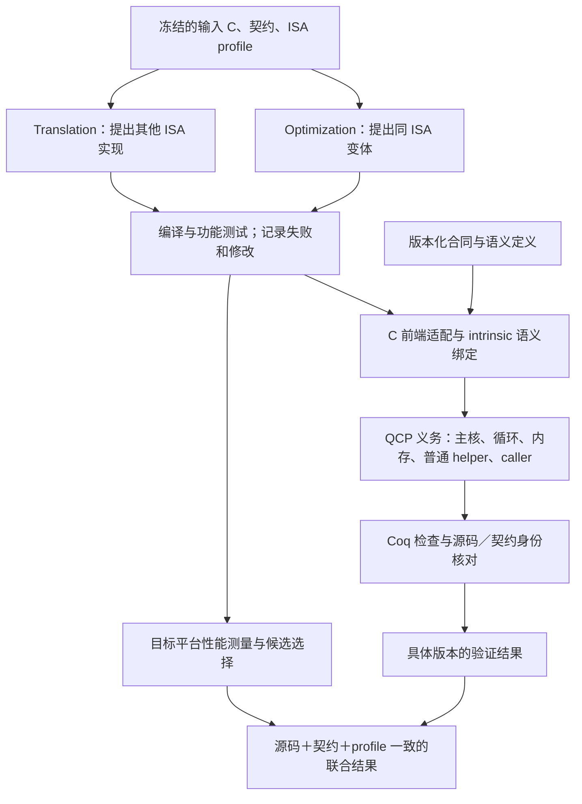

# SIMD kernel 迁移、优化与验证：ECOOP 项目规划草案

**最新交付：** 用户已授权生成[中文版论文式初稿](vekto-paper-draft-20261103/paper.zh-CN.md)、[英文版](vekto-paper-draft-20261103/paper.en.md)和 LaTeX 表格。[完整包说明](vekto-paper-draft-20261103/README.md)列出图片、表格源码与复现脚本。正式结果仍待填；模拟性能图仅在附录作排版预览。完整 LaTeX 正文尚未生成。

**最新论文信息：** [Vekto 定位、Keagan 最终 35 核来源、性能对齐与 Overleaf 宏](PAPER-POSITIONING-AND-METADATA.zh-CN.md)；[论文规划](PAPER-PLAN-FOR-REVIEW.zh-CN.md)；[模拟数据图表预览](paper-plan-figures/synthetic-preview/README.md)。模拟值只用于审美，不是实验结果；正文 LaTeX 尚待确认。

**当前实验方案：** [35 项优化验证、5 项 AVX 扩展、XNNPACK 交叉检查、应用验证及三个案例](EXPERIMENT-DESIGN.zh-CN.md)。这是用户新提出的规划，优先于下文旧安排；不是已完成结果。

**重要更新（2026-11-03）：** 见[Kernel 验证执行与多进程协作规范](KERNEL-EXECUTION-POLICY.zh-CN.md)，包含逐项成本、源码修改边界、证明复用及独立 Codex CLI worker 的监督要求。用户已核查旧 40 项为中间版本；下文的历史记录不代表最终论文实验进度。监督机制尚未实现。

日期：2026-11-02（America/Los_Angeles）。这是讨论稿与项目笔记，不是已确定的实现承诺或论文结果。用户已澄清会议为 **ECOOP**；沿用此前讨论的 **Experience paper** 定位，投稿年份和轮次尚未确定。本轮做了源码、历史记录和文献核对，没有重跑 Coq/QCP、生成新 kernel 或测量新性能。

## 1. 先把项目说清楚

建议的一句话定位：**为真实 SIMD intrinsic C kernel 的跨 ISA 迁移和同 ISA 优化建立可复用的验证基础，并研究保留原实现、精确数值行为与目标性能之间的实际取舍。**

系统围绕三个环节组织：translation 提出目标实现，optimization 搜索性能更好的实现，verification 判断具体版本是否满足冻结的行为合同。候选生成可以由 LLM、已有实现或人工提供；性能由目标平台测量；证明由独立检查器验收。证明容易通过、实际跑得快和保留原始源码结构，是三个需要同时评估的性质。

当前最重要的下一步是先把既有 40 项的源码身份、修改接受状态、证明范围和性能版本对齐；随后完成少量“已验收 baseline → 优化版本 → 同合同再验证 → 同平台性能”的闭环，再试 AVX 第三端。Hexagon/HVX 可先从整数或位操作试点，暂不让四 ISA 全覆盖成为论文的前置条件。

### 用户本轮表达的意图与已确认政策

- 基于 SALTy-rn 的 C-shim-V2 工作，整理 kernel repair、结果审查、前端验证与项目进度。
- 用 C 层的 intrinsic 解释/合同连接两份 kernel，研究 NEON、RVV、AVX、Hexagon/HVX 的迁移和等价性。
- 不只做 translation，也要做 optimization；最终需要覆盖全部 kernel 的性能台账。
- 先写 Markdown 梳理 motivation、框架、形式化表达和实验，尚未确定所有方向。
- 用户更正：目标是 **ECOOP**，不是语音识别得到的 ECCV。
- 用户确认：**“NEON 的个别修复也可能接受，但需逐项确认。”** 因此不把 NEON 修改一律判为禁止，也不把已有证明视为修改获准。公开契约的变化另列，不随 repair 默默改变。

以下路线、样本和实验规模均是助手建议；不会自动变成用户已批准的源码改动。

## 2. 当前进度：已有证据与未完成事项

### 2.1 核对的是哪个版本

主工作区仍在 `feat/assembly-reduction-lean@978bc31b8`，存在其他未提交工作，本轮未改动它们。`build/qcp-kernel-framework` 的本地 `c-shim-v2@3cf039008` 是早期版本，落后远端跟踪分支 62 个提交，不能拿其 5/40 描述当前进度。

本轮固定审阅 `origin/c-shim-v2@821969733d7953a212c51839194add416fd5799b`。该快照的 [manifest](https://github.com/Etha-Sun/SALTy-rn/blob/821969733d7953a212c51839194add416fd5799b/verification/qcp/verified/manifest.json) 登记 **40/40**；通过 GitHub connector 读取的 `c-shim-v2` manifest 同样登记 40/40。本轮重新核对了 40 份 status 和 40 份 spec 的登记 SHA-256，全部一致。这个结果是身份检查，不是新证明运行，也不代表历史日志、全部依赖和所有模型均已重新审计。

| 工作项 | 可以说到哪里 | 还不能说什么／缺口 |
|---|---|---|
| NEON↔RVV C-shim 整核包 | 40 项有既有签发记录；在各自公开契约与 intrinsic 规格下的模块化部分正确性/观察等价 | 不是 40 个未改源码、任意 VLEN、完整终止性或真实机器端到端等价定理 |
| 源码保留与修复 | 80 份主文件已重新对比；修复版和兼容版有记录 | 每项修改是否获用户接受仍需独立登记；小 diff 不代表语义不变 |
| 前端与 helper | 包内有 QCP 目标、Coq 接口、普通 helper/caller 证明及源码绑定 | 实际验证输入不总是原始 C；通用 lowering/ABI/编译器 refinement 尚未建立 |
| intrinsic 建模 | 有官方来源、合同、Coq 定义及部分 C-body 证明 | 人工语义审核仍未整体完成；不能说只需审一次统一库 |
| 真正共享的语义库 | 基础定义存在复用 | 10 份 `FmaModel.v` 逐字相同但仍是副本；8 份 `IntrinsicModel.v` 有 3 种文本，其中 6 份相同；统一依赖源与语义身份管理仍需建设 |
| AVX、HVX | 已有 XNNPACK 源码交集调研 | 本轮未找到已签发的新架构整核证明，仍是扩展候选 |
| 性能 | 已有局部 RVV 优化实验，见下文 | 全 40 项同版本、同合同、同 profile 的证明与性能联合表尚未形成 |

这里的“40 个 kernel”沿用 catalog 条目计数，不等于 40 个互相独立的算法家族。多个逐元素变体应另按家族统计。不同包对 NaN、符号零、内存别名、padding、VL 选择的政策不同，不能用一个全局口号覆盖。

### 2.2 之前的逐 kernel 审查已经找回

聊天 **“评估 c-shim-v2 审核进展”**（ID `01a165d0-72ea-7dd3-aab0-cb6fe985416d`）已有完整主文件对比与改动阈值统计。本轮直接从固定 Git 对象重新计算，复现如下累计结果：

| 两侧主文件合计改动上限 | kernel 数 /40 |
|---|---:|
| 0 行 | 10 |
| ≤5 行 | 18 |
| ≤10 行 | 22 |
| ≤20 行 | 31 |
| ≤50 行 | 33 |
| ≤100 行 | 35 |

口径：去掉注释、空行，按每行词法 token 消除空白差异；每个修改块计 `max(删除行数, 新增行数)`。**不包含新增 helper 和宏展开，不是 AST/语义距离，也不决定修改是否可接受。** 详见 [40 项进度表](kernel-progress.csv) 与 [身份及统计证据](snapshot-audit.json)。

需要优先人工判断的代表案例：

| 案例 | 已看到的变化 | 为什么值得单独审查 |
|---|---|---|
| F32→F16 | 两侧合计 4 行，十六进制浮点常量换成精确十进制表示 | 接近前端兼容问题；仍要确认常量精确同值与解析类型 |
| F32 GEMM | 合计 61 行；NEON 外层控制兼容，RVV 修复 NaN clamp 等 | 原 RVV 有合法 NaN 反例；修复版证明不能回填到原版；[修复记录](https://github.com/Etha-Sun/SALTy-rn/blob/821969733d7953a212c51839194add416fd5799b/verification/qcp/verified/f32-gemm-minmax/repair.md)明示缺少原 do→while 的独立 refinement 定理 |
| Exp-minus-max | 合计 81 行；RVV 请求 AVL=4，重建参考归约树和尾部顺序 | 严格 FP 观察可能要求限制求和重结合；需量化修复的性能代价 |
| Maxpool / PackW / Argmaxpool / DWCHW | 分别合计 131 / 150 / 155 / 166 行 | 涉及控制、helper、写入方式或数据组织，不能只按功能名称复用旧成绩 |
| HWC→CHW | 合计 420 行；NEON 主文件 650→219 行，另有普通 helper；RVV 有加载、clamp、边界和写序修复 | 大规模结构调整；须审查整个 C 调用闭包，区分 bug repair 与为证明重构 |

同一聊天后来转述了**更新的结构保持版本**：Maxpool 846 条 C 义务通过、HWC 128 个支持模块通过但尚未重新准入。所指 `build/qcp-worker-local/structure-preserving-reverify/CONTINUE_PROMPT.zh-CN.md` 本轮仍不在本机已知位置。这是**之前聊天中的报告，尚未独立核实**，不是用户本轮对最新状态的确认，也不能直接计入新的整核通过数。用户本轮补充：可能在其他分支或服务器。将其保留为后续核对项；当前继续使用固定提交，不把定位该目录作为整体工作的前置条件。若以后采用这些更新版作为实验输入，再核对其身份和证据。

### 2.3 已有性能工作不能遗漏，也不能直接并入 proof 结果

[近期局部实验报告](../sol-pipeline-comparison-20261030/round5-paper-bottom3/REPORT.zh-CN.md)记录：IGEMM **1.325×**、Exp-minus-max **1.234×**、GEMM **1.010×**，分别相对该实验冻结的 RVV baseline。实验在 Saturn RTL 的 VLEN=512 配置上测量；本轮没有重跑。这些候选经过功能测试，**没有 QCP/Coq/Lean/SMT 形式验收**。

这些是有用的优化候选和硬件测量基础设施，但不是当前 C-shim 修复包的性能。尤其 C-shim 许多包固定 VLEN=128：即使函数名相同，也不能把 VLEN=128 的证明与 VLEN=512 的测量合并成“已验证加速”。需要同时对齐源码、语义/契约和硬件 profile，或另证参数化/目标配置的结果。

原 SALTyRN 的旧 PDF 32 benchmark、后续作者报告 35 kernel、本项目 catalog 40 项属于不同版本，不合并作分母或宣称完整复现。

## 3. 框架与 motivation

### 3.1 从 SALTyRN 和 Autocomp 借鉴什么

SALTyRN 的现实起点是成熟 NEON 软件资产与 RVV 移植需求：仅逐条搬运固定宽度操作可能浪费 RVV，而改变循环、VL、尾部和算术又会引入错误。作者流程先迁移并做有界符号等价检查，再优化 RVV 并重新验证最终赢家。这个出发点支持我们的“迁移＋优化＋验证”主线。[作者报告](https://riseproject.dev/2026/07/27/saltyrn-turning-neon-kernels-into-fast-verified-rvv-code-with-llms/)

Autocomp 提供结构化优化规划、候选生成和硬件反馈搜索；所读 v3 §3.3 用随机功能对照筛选候选、用周期级仿真评估性能，不能称作无界整核形式证明。可以借鉴其 baseline、消融、预算和 schedule reuse 实验，而不必重新实现全部搜索框架。[Autocomp v3](https://arxiv.org/html/2505.18574v3)

我们的候选研究问题是：**对已有 intrinsic C，验证能否覆盖真实循环和内存，并在新增实现、优化版本及 ISA 时复用；为此实际需要多少模型审查、源码修改和证明工作？** 这种经验问题比“首次将 LLM、翻译和验证结合”更准确。ECOOP 的 Experience 类别包含已有 PL 技术的实际应用、工具和有启发的负结果；它仍需要可复查、能推广的经验结论。[官方类别说明](https://2027.ecoop.org/track/ecoop-2027-technical-papers)

### 3.2 系统如何组织

上图是目标组织方式；不是声称已有统一自动端到端实现。便宜测试与性能探索可先筛候选；正式报告为 verified 的赢家必须通过对应的完整证明。候选失败时保留 baseline，不能只报告幸存的快版本。

所谓“共同 C semantic”宜解释为**已有 C 推理基础＋明确的 ISA intrinsic 语义环境＋kernel 观察合同**，而不是新建完整 ISO C 语义或把不同 ISA 的同名操作强行等同。现有政策也不要求每个 intrinsic 都有 C body：可以采用公开、可追溯的 spec 与 Coq 定义；普通 helper 仍要证明实际函数体。[intrinsic 政策](https://github.com/Etha-Sun/SALTy-rn/blob/821969733d7953a212c51839194add416fd5799b/verification/qcp/docs/INTRINSIC-SPEC-POLICY.zh-CN.md)

用户口述的“code stream 解释”暂按这层语义解释理解，不假定它是已实现的 IR 名称。

## 4. 如何用 PL 论文的方式形式化

**以下是论文定义和证明义务草案，不是本轮新增的机械化定理。** 形式化的目的在于精确说明保证与边界，无需为增加符号而发明新演算。

### 4.1 被验证的对象

令一个实现节点为

\[
v=(K,P,h,\pi,\Gamma,D,\mathcal O),
\]

其中 `K` 是算子/算法，`P` 是实际被验证的 C 程序及普通 helper 闭包，`h` 是源码和依赖身份，`π` 是平台配置，`Γ` 是 intrinsic 语义环境，`D` 是合法输入域，`O` 是输出与内存的观察方式。`π` 必须包含有关的位宽、端序、VLEN/SEW/LMUL、允许的 VL 选择、mask/tail、舍入和 FP 状态。

给每个 intrinsic 一个状态关系，而不必假定都是纯函数：

\[
\Gamma_\pi(i)\subseteq (\mathrm{Args}\times\Sigma)\times(\mathrm{Result}\times\Sigma).
\]

`Σ` 包含所需的内存、向量与配置状态。关系表达可允许的非确定性。load/store 必须记录地址、活动 lane、可读写范围与 frame；整数要区分 wrap、扩宽、移位与饱和；FP 要区分融合/非融合、NaN、符号零等。不能把 RVV agnostic lane 直接设零并当成完整架构语义。

### 4.2 程序判断与关系合同

使用现有 C 逻辑表达

\[
\Gamma;\pi\vdash\{\mathrm{Pre}(x)*R\}\ P\ \{\mathrm{Post}_K(x,o)*R\}.
\]

`R` 表示被证明保留的内存资源。该式在部分正确性解释下约束返回时的状态；它本身不声称一定终止。安全性由对应的 C 安全义务表达，不能仅凭两个终止输出相等推出内存安全。

两份程序的共同逻辑输入可通过不同表示编码，定义关系 `I(x,σ₁,σ₂)` 对齐初态。候选部分等价性质是：

\[
\begin{aligned}
\forall x,\sigma_1,\sigma_2,\tau_1,\tau_2.\quad
&D(x)\land I(x,\sigma_1,\sigma_2)\\
&\land\langle P_1,\sigma_1\rangle\Downarrow_{\Gamma_1,\pi_1}\tau_1
\land\langle P_2,\sigma_2\rangle\Downarrow_{\Gamma_2,\pi_2}\tau_2\\
&\Longrightarrow E(\mathcal O_1(\tau_1),\mathcal O_2(\tau_2)).
\end{aligned}
\]

这里量化全部允许的终止结果，而非选择方便的 VL 路径。另列各侧的安全/frame 结论；若主张 total equivalence，必须再证明合法初态下两侧终止，避免不终止时关系真空成立。实际各包的合同需逐一映射到这套记号，不能假定自动满足。

`E` 可以是位模式相等、数值相等或双方 NaN、精确整数相等，或者单独研究的误差界。必须在实验前固定。`+0` 与 `-0` 是否可互换取决于观察；若后续程序会区分它们，数值等价不自动是上下文等价。两个实现相差 1 ULP 的关系也不能无损传递到任意长路径。

### 4.3 共同规格与直接关系证明

若两侧分别返回共同逻辑结果 `F_K(x)`，或返回它在同一等价观察下的代表，则可组合得到跨实现关系。`F_K` 可以忠实表达参考 kernel 的运算次序，不必先宣称它等于理想实数算法。

直接关系证明同样是合法基线，也能复用参考侧证明。不能把所有 pairwise 方法都说成必须做 `m(m−1)/2` 次独立证明，再宣称共同规格把复杂度降到 `O(m)`；星形或生成树本身已只需 `m−1` 条边。应实测共同模型、内存引理和不变量减少了多少**新增工作**。

图的边既可以是 NEON→RVV，也可以是 RVV baseline→RVV optimized。组合必须对齐中间版本、profile、输入表示、合法域和观察。若采用部分正确性关系做一般路径传递，还需防止中间实现没有终止结果导致的真空推理；共同规格或显式终止证据能让组合条件更清楚。

### 4.4 哪些桥目前仍在信任边界内

| 环节 | 需要建立的事实 | 当前写作口径 |
|---|---|---|
| 原始 C → 适配后 C | 控制流、求值次数、地址与观察保持 | 原样文件可直接核身份；改写按实例/规则补证或明确保留为审查边界 |
| intrinsic → 语义模型 | 官方语义与采用的 Γ 对应，抽象观察合理 | source-reviewed spec 与人工审核状态单列；不是整套 ISA refinement |
| C 前端/VC 生成 → Coq 判断 | 生成义务与实际 C 的连接成立 | 说明工具版本和信任依赖；Coq 成功不能自行证明前端 soundness |
| 主核、普通 helper、caller | 全部真实 C 义务闭合，调用前提有来源 | 当前签发包的主要成果；不能只验证预先假设输出相等的 wrapper |
| C → 编译器/ABI/机器执行 | 目标代码保持相关语义 | 编译、差分、ISA/SDK 检查提供补充证据；不提升为未建立的机械化桥 |

可以把“模块化组合定理”和“前端适配规则的局部保持性”作为少量真正有用的形式化任务；不要求本篇 Experience paper 先完成整套硬件证明。公开 TCB、显式前提、库假设和语义审核入口，比将所有 `Print Assumptions` 简写成“无假设”更有说服力。

## 5. XNNPACK 扩展样本：有哪些、长什么样

找回了[四端调研](../ecoop-experience-reading-20261024/xnnpack-four-isa/README.zh-CN.md)：固定 XNNPACK `23dd5070fa002ef0b124817798ae090fa29f9653`，34 份构建清单中识别出 **77 个 NEON/RVV/AVX 家族/HVX 交集条目，覆盖 49 个源码目录**。这是 2026-10-24 的固定快照，不声称本日最新上游全量支持，也不是 77 组精确等价程序。

NEON、RVV、AVX、HVX 是四组架构相关 intrinsic 接口，不是四种独立高级语言。AVX/AVX2/AVX-512、FMA 与 HVX 架构版本必须具体标明。现成四端实现可先作为验证输入；成功验证它们不等于已实现自动四向翻译器。

[本次精选源码表](XNNPACK-SAMPLES.zh-CN.md)逐项给出四端固定链接及 PROD/NON_PROD 属性；[全部 77 项](../ecoop-experience-reading-20261024/xnnpack-four-isa/FULL_MATRIX.zh-CN.md)供后续扩展。

| 候选 | 计算形态与代表性 | 可行性判断与主要义务 |
|---|---|---|
| `s8-vclamp` | `y[i]=min(max(x[i],lo),hi)`；NEON/RVV/AVX2/HVX 的不同分块 | 首批；精确整数观察，证明 lane 对应、tail 及访存；HVX 可能整向量读尾部 |
| `f32-vabs` | binary32 清符号位 | 首批位操作；检查 NaN 位模式、load/store 和 FP profile，不引入实数近似 |
| `f32-vcopysign` | A 的数值位与 B 的符号位组合 | 首批双输入；位表示、符号注入、别名与尾部 |
| `f32-vadd` | 固定宽度块＋尾部，对比 RVV 动态 VL 循环 | AVX 第三端首选，可接已有经验；HVX 先核版本/qfloat/IEEE 路径，不能预设一致 |
| `qs8-vadd`（minmax） | 扩宽、参数缩放/移位、饱和与打包 | 第二批；检查每一步舍入和饱和，不只比较抽象 `a+b` |
| `qs8-rdsum` | 多行有 stride 的 int8→int32 累加 | 第二批；循环不变量、旧输出、模运算/溢出和 padding |
| `x32-transposec` | 不同 tile 的二维置换：RVV 4×4、AVX 8×8、HVX 32×32 等 | 第二批非算术复杂例；逻辑矩阵关系、边缘块和 segmented/strided 访存 |
| `f32-vneg` | `0−x` 与翻转符号位的实现差异 | 负例/观察敏感性样本；在 RNE、输入 `+0` 时可产生不同符号零，不自动是库 bug |

以 VADD 为例，实际 [AVX u8](https://github.com/google/XNNPACK/blob/23dd5070fa002ef0b124817798ae090fa29f9653/src/f32-vbinary/gen/f32-vadd-avx-u8.c)每轮处理 8 个 float，尾部使用 mask 表加载、masked load 和分段 store；[RVV u4v](https://github.com/google/XNNPACK/blob/23dd5070fa002ef0b124817798ae090fa29f9653/src/f32-vbinary/gen/f32-vadd-rvv-u4v.c)使用 e32m4 动态 VL。这说明新增 AVX 需要模型化 mask 和地址操作，并不是只加一条 add 定义。这个 XNNPACK RVV m4 实例与现有 C-shim 的 VADD m8/容量32实例也不是同一份代码。

建议试点：**先 VADD 的 NEON/RVV/AVX 三端，加 `s8-vclamp` 或位操作的 HVX 第四端；再扩展到上表 6–8 个代表家族/操作。** 不将同模板的许多变体当成独立算法广度。最小改造方式是附接固定上游实现，随后才测试生成器能否产生新实现。

必须保留的反对证据：HVX 的浮点除法/平方根存在倒数或倒平方根近似路径；浮点 reduction 的顺序/精度可能不同；HVX tail 读可要求更大 padding；PackW 的 nr/kr/sr 不同会使物理输出布局不同。`u8-vclamp`、`f32-vcmul` 等在该清单缺 HVX，不能直接从当前 40 项任挑一个就宣称四端齐全。上述限制及源码入口已在原调研中记录。

## 6. 源码修改的接受与重新验收

建议每个 kernel 保存五个可区分对象：`原始参考 S0`、`原始译文 T0`、`接受的修复版 S1/T1`、`前端实际验证输入 V`、`优化候选 T2`。若 NEON 被修复，也必须保留 S0，写明缺陷、合同与接受状态；不能让两侧一起改变到一个新的错误结果，再用相互一致当作原任务完成。

| 修改类别 | 处理方式 |
|---|---|
| 证明注释/构建路径 | 核对普通 C 和合同未变；避免注释通道引入新假设 |
| 精确常量、表达式拆分、do→while 等兼容改写 | 记录适用前提、求值顺序与局部保持性证据；不默认所有此类改写都安全 |
| 真正 bug repair | 保存合法反例、原版、精确 patch 与修复后独立 oracle；NEON 个别修复逐项确认 |
| helper 提取、控制/访存重构 | 审整个普通 C 闭包，检查是否改变访问、指令选择或性能；不能藏在 intrinsic 豁免中 |
| 性能优化 | 保留冻结合同，对新版本重新检查；不能通过缩小输入域制造通过 |
| 输入域/观察关系变化 | 单独的规格变更，不与源码微调合并；按新实验配置报告 |

每案台账至少包含：原始/实际源码 hash、改动类别和原因、用户接受状态及依据、intrinsic 绑定/审核状态、合法域和观察、证明运行 ID、native/目标 SDK/反例回归、性能 profile/ELF hash。**没有记录的批准状态写“待确认”，不能从 variant=repaired 推断允许或禁止。** 当前 CSV 对这一点保留未知。

重新验收以受影响版本为单位：先小案例验证环境，再按照依赖顺序有限预算执行；源码、普通 helper、模型、规格或前端变化都要追踪受影响依赖。历史证书保留，新记录另存。若性能文件不是验证输入本身，需证明/核对二者对应；计时必须运行生产 intrinsic 实现，不能测 host shim 或证明 wrapper 的速度当作目标 kernel 性能。

## 7. 实验设计：每项实验要回答什么

建议将全 40 项用于覆盖审计和基础性能台账，6–8 个代表样本用于深入比较，先用 3 个样本完成优化闭环。新增实验证据之前，下面都是计划。

| 编号 / 问题 | 对照与操作 | 报告指标及产物 |
|---|---|---|
| E1 覆盖到底有多少可信内容？ | 固定 40 项；按原版/兼容/修复/重构、家族、语义边界分层重验 | 尝试/通过/反例/unknown/环境失败；输入域、VLEN、人工审核和批准状态；分母含未完成项 |
| E2 验证发现了什么？ | 对已知合法反例比较原生差分、有界检查、完整 C 证明；使用同一模型/域可比较子集 | 漏检和发现类别、最小反例、首个发现阶段；不能将证明超时记为程序错误，也不把不同模型的差异全归因于方法 |
| E3 修复和适配代价是什么？ | 原版→兼容→修复→结构保持修复版；同平台比较可运行版本 | 主文件和全闭包改动、helper 增量、验证成本、正确性修复性能税；错误原版的快速度仅作诊断，不能进入“正确实现加速”主表 |
| E4 优化后有多少收益能被验收？ | 同一 target 上比较已验收 baseline、仅测试赢家、形式验收赢家；候选集和预算尽量相同 | 每 kernel/shape cycles、speedup、回退数、验证接受率和总成本；展示未能证明的快候选 |
| E5 加 ISA/新 kernel 的成本是否下降？ | 附接 AVX，精选 HVX；对照逐案包与共享库；直接关系/固定参考基线也允许复用 | 首次模型审查与证明成本、每新增实例成本、重用定义/引理、实际重检依赖；按家族留出避免只测模板复制 |
| E6 语义与工具边界如何影响结果？ | 不同 tail 长度、VL 选择/profile、NaN/±0、alias/padding；负例及失效注入 | 失败分类、观察敏感性、资源扩展曲线；规格变化作为单独实验，不选对本系统最有利的域 |

### 性能协议

1. 对全 40 项建立状态表：测到的数值、编译失败、无设备、合同未对齐、尚未重验分别记录。目标是最终测全，不以现有三项替代。
2. 同 ISA、同硬件/模拟器上比较候选与 baseline；可用时加入手写 XNNPACK、SALTyRN 公开输出和 scalar autovec。不同设备的 NEON/AVX/RVV 绝对时间不能直接当作翻译算法的公平优劣。
3. 固定源码、compiler/flags、FP 模式、VLEN、输入/packing、对齐、warm/cold 条件与计时边界；把正确性比较放在计时区外，防止 dead-code elimination。
4. 形状覆盖小规模、整块、tail 与较大输入；先记录主测集合，再看结果。真实硬件重复测量并给变异/置信区间；确定性 RTL 报周期及复放一致性，不伪造统计噪声。
5. speedup 定义为 `cycles(baseline)/cycles(candidate)`；先逐 shape，再逐 kernel 汇总，再跨 kernel 汇总，说明权重，避免形状多的 kernel 主导总体。失败项单列，不能悄悄从分母移除。
6. 仅测试赢家和已证明赢家使用明确标签；没有覆盖测量 profile 的证明时，表中不能标为该配置 verified。

### 验证成本与 LOC 协议

记录 wall time、CPU、峰值 RSS、冷构建/增量构建、agent token/实际费用（可得时）、尝试次数和人工审核时间。首次共享模型成本要计入，不能只比较摊销后数字。

LOC 至少分成：原始 C、实际 C 主核、普通 helper、intrinsic 合同/语义、证明注释、手写 Coq、自动生成 Coq/VC、工具代码。每类报告 raw、精确文本去重和已识别共享定义；大段逐 lane 展开另列。VC 字段数、Coq 模块数、定理数、intrinsic 名称数和 kernel 数不可互换。先前约 2.5 万 LOC 的粗计包含 helper/重复副本，不能直接用作“intrinsic 最小建模成本”。

优化规则库是第二阶段可选实验：比较逐实例证明与已证规则实例化，先选保序展开、逐元素分块等；浮点重结合不能无条件采用。此前[规则调研](../verified-optimization-rules-20261030/REPORT.zh-CN.md)保留，不为了本篇论文同时重建 IR、编译器与完整规则系统。

## 8. 论文可以怎么写，怎样避免“系统太简单”

工作标题候选：*Reusable Verification for SIMD Kernel Porting and Optimization: An Experience Report*。

论文要让读者记住的应是：**验证真实 SIMD 改写时，可复用的部分与必须逐案处理的数值、内存和源码边界分别是什么，以及这种复用的实际成本。** 目前证据支持“已有可审查的多 kernel 模块化证明包，同时存在修复与共享问题”；还不支持“统一库已经显著降低成本、优化收益已全部保留、四 ISA 已打通”。

| 候选主张 | 支撑证据 | 会削弱/推翻它的结果 |
|---|---|---|
| C/intrinsic 合同能支持真实 kernel 的可审查验证 | E1/E2；完整控制流、内存和 helper，合法反例与模型审查 | 主要成功来自缩域、改变参考或隐藏未证明 helper；则收窄到具体修复包 |
| 一套验证基础可支持迁移与有性能价值的优化 | E3/E4；同源码/合同/profile 的联合结果 | 只能验证近乎相同结构，或所有收益被修复/证明要求消除；报告此限制 |
| 模型与证明复用降低新实现的增量成本 | E5/E6；允许复用的强基线及首次成本 | 新 ISA 仍需逐 kernel 重写大部分模型/证明；不能仅凭文件去重宣称可扩展性 |

建议正文顺序：

1. **Introduction**：成熟代码资产的迁移需求；优化需要结构变化；现有检查与完整程序保证之间的差距；明确 Experience 问题。
2. **Motivating example**：VADD 展示固定宽度/动态 VL/尾部；再用 NaN clamp 或 Exp 归约展示一对“性能有意义却语义敏感”的变化。
3. **Contract and guarantee**：第 4 节的实现节点、语义环境、观察关系、部分正确性与信任边界。
4. **System**：候选生成、语义绑定、QCP/Coq、修复记录与可复用组件；说明实际人工参与。
5. **Evaluation**：E1–E6，先覆盖/正确性，再性能与增量成本；展示负结果。
6. **Lessons and limitations**：原代码保留、FP 观察、tail/布局、前端表示、共享库维护成本。
7. **Related work**：SALTyRN/Autocomp，加 Hydride/MISAAL、Minotaur/Alive2、MetaLift/Tenspiler、SIMDe/Highway 等；按完整 C 循环、内存、数值保证与复用范围比较，不只比较后端数量。

近邻来源和已读范围见[已有定向调研](../ideas/005-multi-isa-c-contract-graph-ecoop.zh-CN.md)与[论文阅读包](../ecoop-experience-reading-20261024/README.zh-CN.md)。此处未重新完整审计所有近邻实现，正式 related work 前需按所选主张复核。共同 IR、模块化合同、等价传递性和“证明一次后复用”本身都不是可直接主张的新颖性。

审稿人最可能追问：

- **“是不是验证了被重写得更容易的程序？”** 用 E1/E3 的原件、全闭包 diff、修改接受状态与性能税回答。
- **“模型会不会把真实差异抹掉？”** 展示定义来源、FP/tail 负例、模型绑定审核和未建立的 ISA 桥；不能用相同模型下自比较作独立验证。
- **“只是把现成 QCP 用了一遍？”** 用可复用的建模/前端经验、真实失败与成本对照回答；若没有增量收益，降低统一框架主张。
- **“跨 ISA 图比固定参考好在哪里？”** 允许固定参考基线复用，用实际新增成本和依赖变化回答，不用虚假的二次复杂度优势。
- **“加速是不是来自不正确版本或不同配置？”** 用 E4 的版本/profile 绑定与错误/未证明候选单列表回答。

系统简单并不是问题。若贡献仅是“用 shim 替换 intrinsic 后调用证明器”，论点会偏薄；若能给出完整程序保证的边界、真实语义错误、结构保持的适配方法以及可测的复用/性能成本，就有值得写的经验内容。现在仍需实验确认，不能仅凭规划判断稿件已达到投稿标准。

## 9. 推荐实施顺序与完成标准

| 阶段 | 具体产物 | 完成标准 |
|---|---|---|
| P0 统一版本与审计 | 以已核对提交冻结 40 项身份；逐核批准/待确认表；其他版本列作待核对 | 每项有明确原件、实际版本、合同、审核和重验状态；采用更新版时另核对证据 |
| P1 小闭环 | VADD＋一个整数复杂核＋GEMM/Exp 中一个，原生检查/证明/性能对齐 | 至少包含一个真实结构变化；所有联合主张绑定同一源码和 profile；失败可复现 |
| P2 全集基础实验 | 全 40 项功能与性能尝试，受影响证明按预算重验 | 每项有结果或具体阻碍，失败计入台账；所有可发布版本状态清楚 |
| P3 多 ISA 小试点 | VADD→AVX；clamp/位操作→HVX；成功后扩为 6–8 个样本 | 有完整新端 C/helper/caller 证据，记录新增成本；无 HVX 设备则只报告模型结果 |
| P4 论文证据收束 | 主张—实验映射、失败分类、成本和可复现 artifact | 保留被数据支持的主张；第四端/规则库未完成时明确放展望 |

这些是依赖顺序，不是未经估算的日历承诺。若目标是临近轮次，应优先把 P0–P2 做扎实，收窄扩展承诺；用户尚未指定投稿轮次。

结构保持重验目录的位置/提交只影响 Maxpool/HWC 更新版的状态确认，不改变已有固定快照的证据，也不阻碍整体规划或其他样本推进。无需为此暂停项目。

## 10. 本轮证据与复核入口

- [kernel-progress.csv](kernel-progress.csv)：40 项 variant、改动量、状态/规格 hash 检查，以及明确保留未知的批准、重验、性能绑定字段。
- [snapshot-audit.json](snapshot-audit.json)：固定提交、80 份主程序哈希、计数与重复模型分组。
- [collect_snapshot.py](collect_snapshot.py)：只读固定 Git 对象的可重跑统计；只写本目录派生表，不调用证明器，不覆盖历史证书。
- [XNNPACK-SAMPLES.zh-CN.md](XNNPACK-SAMPLES.zh-CN.md)：8 个候选的 32 个固定源码入口。
- [既有审核索引](https://github.com/Etha-Sun/SALTy-rn/blob/821969733d7953a212c51839194add416fd5799b/verification/qcp/docs/VERIFIED-REVIEW-INDEX.zh-CN.md)：各包的公开合同、intrinsic 定义和证书入口。
- [既有优化结果](../sol-pipeline-comparison-20261030/round5-paper-bottom3/REPORT.zh-CN.md)：局部性能证据，未与本次 proof 快照等同。

复核命令：`python3 research/project-plan-20261102/collect_snapshot.py`。本轮身份检查通过不等于重新编译证明。原有 Sail/Coq 路线与 C-shim 路线保持分开；早期 Sail 加载缺口既不能抹掉新的 C-shim 成果，也不能由 C-shim 成果自动补齐。
