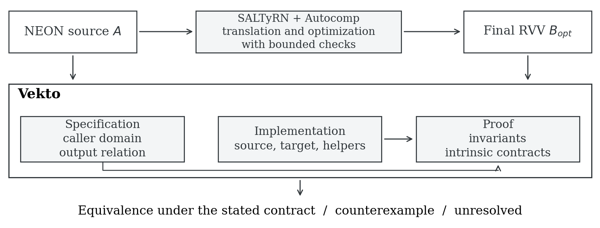
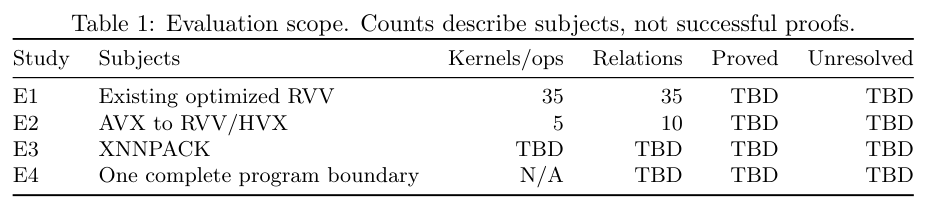
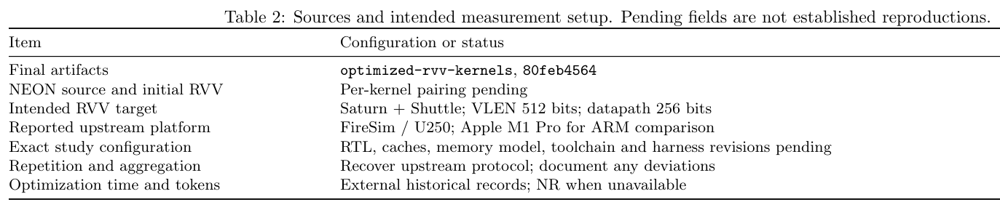
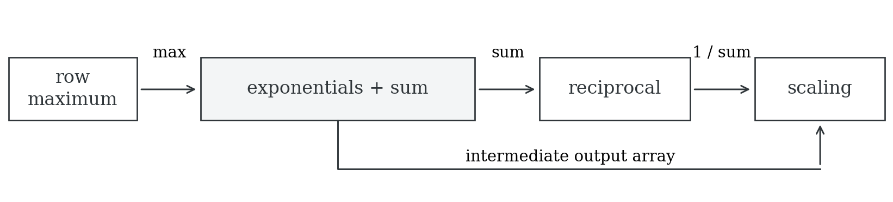
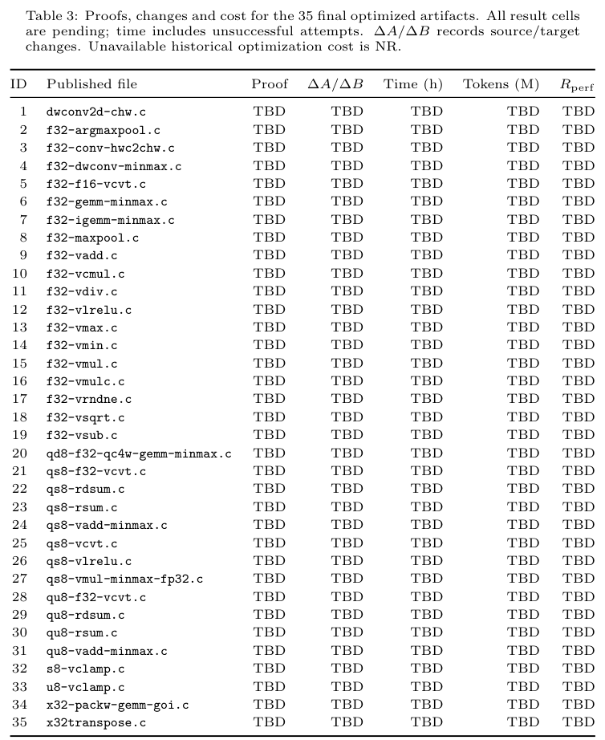
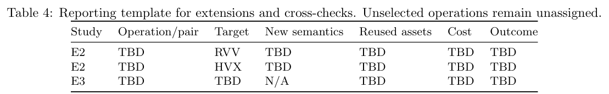
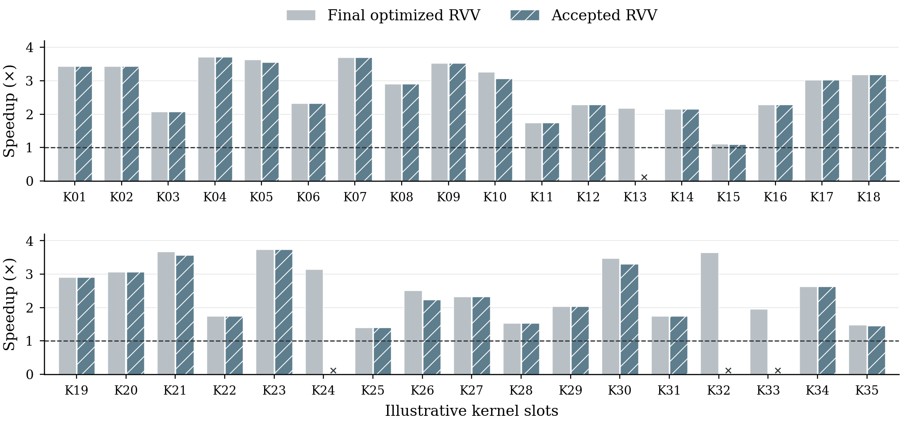

# Vekto: Verifying Semantic Equivalence of Optimized SIMD Kernels

Yuechun Sun · ycsun@berkeley

*Working manuscript, 3 November 2026. New evaluation results are pending. Tables retain unfilled result fields. The synthetic performance illustration in Appendix B is exclusively a layout preview.*

## Abstract

SIMD kernel translation and optimization change vector widths, loop structure, memory accesses, and floating-point computations. Establishing that the resulting implementation preserves the source behavior requires a precise account of both the permitted inputs and the outputs a caller can observe. We present the design of Vekto, a framework for validating these transformations through C-level intrinsic semantics and modular program proofs. Vekto separates the public specification, implementation, and proof, so that proof development can be reviewed independently of changes to the kernel. A common specification connects implementations across instruction sets while retaining architecture-specific numerical and memory behavior. Our evaluation is organized around 35 published final RVV kernels produced by SALTyRN and its Autocomp-based optimization stage, followed by additional ISA ports, cross-checking of independent XNNPACK implementations, and a program-composition study. This manuscript defines the guarantees and evaluation protocol; verification coverage, cost, and performance results remain to be established.

## 1. Introduction

Efficient SIMD code depends on details that vary across architectures. A kernel written with Arm NEON intrinsics may process a fixed number of elements per iteration, whereas an RVV implementation can select an active vector length at runtime. Optimizing a translation may further change its blocking, unrolling, loads, or accumulation order. These changes create performance opportunities, but they also change the reasoning required to justify replacing the source implementation.

The availability of code-generating agents makes this distinction practically relevant. Candidate generation and performance search can produce implementations whose control flow differs substantially from the source. Functional tests provide evidence for the tested executions. A deployment decision additionally needs to identify the intended input domain, the permitted numerical differences, and the relationship between the tested candidate and the program covered by a proof. A proof of a convenient rewrite does not establish the original optimized candidate's correctness.

SALTyRN provides a concrete setting for this problem. It translates XNNPACK NEON kernels to RVV, checks translations using bounded symbolic equivalence verification, and uses an Autocomp-based stage to search for faster RVV candidates. Its published description also includes checking the final optimized candidate against the verified RVV baseline [1, 2]. Vekto studies a complementary validation layer for these artifacts. The distinction is the scope and structure of the guarantee: the admitted lengths and parameters, memory conditions, floating-point observations, and dependencies that are actually covered. An evaluation must compare these scopes explicitly rather than describe the existing framework as lacking verification.

The central design question is whether reusable semantics and modular proofs can establish equivalence while preserving the optimized implementation. We organize this question around three requirements. The specification must describe legitimate calls without excluding difficult cases merely to simplify proof. The proof must cover the implementation and its dependencies, including helper functions and tail paths. Any necessary source change must remain visible, with a separate assessment of its semantic justification and performance effect.

Vekto uses a common specification to connect implementations through their observable behavior. This approach supports both translation validation and cross-checking: an independently written implementation need not be produced by the same translator to be compared. It also creates a possible interface for program composition, provided the intermediate guarantees are strong enough for the consuming code. Shared semantics are useful only to the extent that they preserve relevant differences between architectures and can be reused without introducing assumptions specific to one kernel.

The primary evaluation uses the 35 final optimized RVV source files published separately by SALTyRN [1]. These are existing optimization outputs; the study does not repeat the optimization search. Three additional studies examine new AVX ports to RVV and Hexagon HVX, comparisons between XNNPACK implementations, and a small program assembled from verified components. Their role is to test whether the verification approach remains useful beyond one upstream pipeline. The current manuscript presents the design and experimental questions, without claiming that these studies have been completed.

## 2. A Running Example: Vector Absolute Value

> **Author note, 4 November: motivating example pending selection.** The absolute-value example below remains an introductory illustration. The intended replacement must satisfy the following evidence requirements; no completed result is claimed here.
>
> - Show short NEON and final optimized RVV code that makes differences in vector length, tail handling, or numerical semantics visible, together with an actual intrinsic semantic definition.
> - Present verification feedback and a concrete, feasible counterexample, distinguishing a solver-generated witness from a separately constructed or replayed input.
> - If the candidate previously passed bounded verification, establish that fact for the same source and identify the precise missed condition. A length-one NaN discrepancy does not by itself demonstrate a limitation of bounded input lengths. SALTyRN already supports counterexample-guided repair.
> - Show a minimal repair and verification of the repaired optimized implementation, preserving the source, legitimate input domain, and optimization structure.
> - Compare XNNPACK RVV, optimized RVV, and repaired optimized RVV on the same platform. Identify the incorrect candidate explicitly and quantify repair cost. The intended example should retain an advantage over XNNPACK; this has not yet been established.
> - Typeset editable source with syntax highlighting in the eventual LaTeX manuscript. Do not use code screenshots. No LaTeX implementation is requested at this stage.
>
> Historical `f32-vmax` and `f32-vmin` artifacts are candidates for review, but their old proofs and measurements cover intermediate versions. The final optimized versions still require evidence. See the [candidate review](MOTIVATING-EXAMPLE-REVIEW.zh-CN.md).

XNNPACK's floating-point absolute-value kernels illustrate how a simple operation can require different program proofs. The NEON implementation processes fixed groups and uses a separate tail helper. An RVV variant selects its active length, loads that many elements, applies absolute value, stores the result, and reduces the remaining count. The following lines are taken from the published `rvv_u1v` implementation [3]:

```c
const size_t n = __riscv_vsetvl_e32m1(batch);
const vfloat32m1_t vi = __riscv_vle32_v_f32m1(input, n);
input += n;
const vfloat32m1_t vo = __riscv_vfabs_v_f32m1(vi, n);
__riscv_vse32_v_f32m1(output, vo, n);
output += n;
batch -= n;
```

Here `batch` has already been converted from bytes to elements. Matching the absolute-value operation is only one obligation. The proof must connect the processed prefix to the output, show that pointer updates stay within the permitted memory, and account for the NEON tail helper's actual reads. The RVV model must specify the allowed active lengths. A theorem for one hardware vector length does not become a theorem for all hardware configurations merely because the loop accepts different input lengths.

For a logical input sequence, a common specification describes the absolute value of each element and the memory that remains unchanged. Each implementation can use its own loop invariant and representation of vectors. Its postcondition connects the completed output to that common specification. This decomposition avoids requiring the two loops to take corresponding steps, but it does not remove either loop's memory or numerical obligations.

Absolute value is an initial integration example, not a representative substitute for all optimized kernels. Reductions introduce accumulation order; quantized kernels introduce parameter encodings, saturation and rounding; matrix kernels introduce packed layouts and indirect accesses. These differences determine what can be shared and what must be established for each implementation.

## 3. Semantic Contracts and the Equivalence Guarantee

### 3.1 Logical inputs, memory, and machine configurations

Let \(A\) and \(B\) be the source and target implementations. A logical input \(x\) contains the data and operation parameters that the caller intends to supply. Each side has an input representation, which may use different vector types, parameter encodings, or packed layouts. Preconditions \(P_A(x)\) and \(P_B(x)\) connect these representations to the same logical input and specify the readable and writable memory.

The admissible domain \(D\) comes from the operation and its calling context. It includes shape constraints, allocation sizes, padding, alignment where required, permitted aliases, and valid parameter construction. These conditions are part of the guarantee. In particular, a library may deliberately permit reads from padding beyond the logical array length. Such a read is not an out-of-bounds error if the caller contract supplies that memory, but the proof must still establish that the allocation is large enough.

An ISA profile \(p_i\) records the configuration relevant to implementation \(i\), including vector length, element width, rounding behavior, and the handling of exceptional floating-point values. A proof quantifies over the inputs and execution choices specified by that profile. Coverage of arbitrary legal input lengths and coverage of multiple hardware vector lengths are separate properties.

### 3.2 Observable behavior

We compare caller-visible results rather than internal vector registers. Integer outputs and data-movement results are compared exactly according to their specifications. For the principal floating-point contract, the output relation is

\[
u \approx_{\mathrm{fp}} v
\quad\Longleftrightarrow\quad
(u =_{\mathrm{num}} v)\;\lor\;
(\operatorname{isNaN}(u)\land\operatorname{isNaN}(v)).
\]

Numeric equality identifies positive and negative zero. The second clause ignores the NaN payload. This relation does not allow an arbitrary error tolerance: distinct finite floating-point values remain distinct. Kernels requiring an exact bit pattern or an exact index use a correspondingly stronger observation.

Let \(O_i\) extract the result specified for implementation \(i\), including the relevant output values and return information. For related initial states \(s_A\) and \(s_B\), the partial-correctness comparison has the form

\[
\begin{aligned}
x\in D\;\land\;P_A(x,s_A)\;\land\;P_B(x,s_B)\;&\land\\
\operatorname{Exec}_{p_A}(A,s_A)\Downarrow t_A\;&\land\;
\operatorname{Exec}_{p_B}(B,s_B)\Downarrow t_B\\
&\Longrightarrow O_A(t_A)\approx O_B(t_B).
\end{aligned}
\]

This statement compares terminating executions. Memory safety and preservation of memory outside the permitted writes are additional proof obligations; they do not follow from output equality alone. Termination must also be established separately before claiming total correctness or agreement about termination. The formula specifies the intended judgment and is not a report of a newly checked theorem for the evaluation kernels.

### 3.3 A common specification

Vekto separates implementation proofs from the final comparison. For each implementation \(K_i\), the proof establishes a contract of the form

\[
\{P_i(x) * R_i\}\;K_i\;\{Q_i(x) * R_i\},
\]

where \(*\) denotes separation of owned memory and \(R_i\) describes the framed memory. The postcondition \(Q_i\) relates the implementation's output to a common specification \(S(x,o)\). Two such proofs imply output equivalence only if that specification determines the observation up to the chosen relation:

\[
S(x,o_1)\land S(x,o_2)\Longrightarrow o_1\approx o_2.
\]

A specification that allows a range of approximation errors may admit different outputs that are not equivalent under the relation above. Proving that two implementations satisfy that specification establishes conformance, but does not establish strict output equivalence. This distinction is especially relevant when comparing independently optimized library implementations.

Neither ISA needs to be privileged as the definition of the operation. A suitable reference specification can describe the operation independently. For a translation that must preserve a particular floating-point algorithm, however, the specification may need to retain the source's accumulation order or approximation scheme. The specification must state this choice so that equivalence to a particular implementation is not confused with correctness relative to an ideal real-valued function.

### 3.4 Refining a caller contract

A counterexample can reveal that the current specification admits an input that the original caller cannot produce. In that case, strengthening the precondition can be justified, but rejecting the counterexample is not sufficient evidence. Let \(R(x)\) characterize legitimate calls in the original setting and let \(P_{\mathrm{new}}(x)\) be the proposed precondition. The review obligation is

\[
\forall x.\; R(x)\Longrightarrow P_{\mathrm{new}}(x).
\]

The justification must identify the relevant caller, parameter initializer, allocation contract, or API restriction. It must also explain why the condition is needed. A nonempty domain is a useful check against a vacuous theorem, but does not show that legitimate calls have been preserved. Counterexamples inside the legitimate domain require diagnosis of the implementation or model rather than a convenient restriction of the specification.

## 4. Verification Architecture



*Figure 1. Proposed use of Vekto with SALTyRN and its Autocomp-based optimization stage. The upstream project supplies existing final candidates and already performs bounded checks. Vekto organizes the specification, implementation evidence and proofs needed for an independent equivalence judgment. The figure depicts the study architecture, not an already completed online integration.*

### 4.1 Choosing the verification abstraction

Our exploration considered assembly semantics derived from Sail, an explicit intermediate representation, and C-level intrinsic reasoning. These alternatives expose different proof obligations. Assembly semantics retain register and architectural behavior, but proofs must also handle the relevant memory, machine state and vector representation. An intermediate representation can make common control-flow and memory reasoning explicit, but introduces an obligation to relate the source program to the extracted representation. C-level reasoning retains the source loops and function boundaries, while requiring faithful interpretations of the intrinsics and a clear account of the frontend.

The existing intermediate-representation exploration uses a custom C/intrinsic model called CByte, rather than LLVM IR [4]. CByte and a C-shim are not inherently disjoint categories: both provide an intermediate semantic account of the program. The useful comparison concerns which source operations they preserve, how they represent memory and numerical behavior, and which translation steps remain trusted. Our choice of C-level contracts is motivated by the need to reason about the supplied kernel bodies and their helpers with reusable program-verification infrastructure. The current evidence does not establish that this choice is universally faster than reasoning from Sail or another IR.

### 4.2 Separating specification, implementation, and proof

The public specification describes the operation, its caller domain and the observation relation. The implementation contains the actual source and target kernels and any helpers that affect their behavior. The proof contains loop invariants, layout facts, intrinsic contracts and the derivation of the public postcondition. This organization makes it possible to inspect whether a proof change also changes the program or its admitted calls.

The C-shim approach interprets intrinsics through a shared semantic interface. Vector storage, loads and stores, integer arithmetic, and floating-point operations can contribute reusable definitions and lemmas. Architecture-specific operations retain their own behavior. For example, fused multiply-add must not silently become an unfused multiply followed by addition, and a minimum instruction's NaN handling must not be replaced by an ideal mathematical minimum. The shared interface is useful when it makes these obligations reusable, not when it erases the distinctions being verified.

A verifier can generate many local verification conditions for memory accesses, branches, loops and function calls. Discharging the final comparison function alone does not validate the kernel if its callees are merely assumed to satisfy their contracts. Acceptance therefore requires the implementation proofs and the dependencies used by the final theorem. The reported result must identify the source, specification, semantic model and configuration to which it applies.

### 4.3 Preserving optimized implementations

The default comparison retains the source implementation. If a source defect requires a correction, that correction is reviewed independently rather than silently folded into the reference. Changes to the target are similarly recorded with their concrete purpose: correcting a semantic discrepancy, adapting a representation at the frontend boundary, or changing the program structure. A proof-friendly rewrite is not automatically a justified repair.

When a change is necessary, the evaluation retains both the published optimized target and the modified target. It reports which implementation was proved and which was timed. A small textual diff may still change rounding or the active vector length; conversely, an annotation-only change need not alter executable code. The change record counts added and deleted executable lines separately for each implementation, including affected helpers; annotations and proof text are recorded separately. Line counts support review but do not replace an explanation of semantic and performance effects.

Existing proofs can supply intrinsic lemmas, memory-layout arguments and invariant patterns. Reuse requires matching their assumptions, dependencies and machine profiles to the new candidate. Shared setup cost and the incremental cost of each kernel are reported separately. We do not assume that reuse reduces total cost without an appropriate comparison.

### 4.4 Trust and implementation status

The guarantee is conditional on the semantic models, caller contract and source-to-model correspondence. A checked proof in the C model does not by itself prove that every intrinsic model matches the hardware instruction, that the frontend preserves the original C program, or that a compiler preserves the resulting executable behavior. These boundaries are reported independently of proof-checker acceptance.

Earlier prototypes provide proof infrastructure and experience with intermediate kernel versions. They do not establish results for the 35 final optimized artifacts in this study. Historical assembly proofs, generated traces and conditional theorems also retain their original scope. The evaluation must establish new source identities and proof evidence before transferring a result to the final optimized cohort.

## 5. Evaluation

### 5.1 Research questions and subjects

The evaluation asks whether Vekto can validate existing optimized implementations while preserving their structure and performance, how much work is required to extend the semantic interface, what independent implementation comparisons reveal, and whether the contracts support a complete program boundary.

<!-- TABLE:scope:en:BEGIN -->


LaTeX source: [scope.en.tex](tables/scope.en.tex). [Compiled preview](tables/tables.en.pdf).

<details>
<summary>Editable LaTeX source</summary>

```latex
\begin{table}[htbp]
\centering
\small
\caption{Evaluation scope. Counts describe subjects, not successful proofs.}
\label{tab:scope}
\begin{tabular}{@{}llrrrr@{}}
\toprule
Study & Subjects & Kernels/ops & Relations & Proved & Unresolved \\
\midrule
E1 & Existing optimized RVV & 35 & 35 & TBD & TBD \\
E2 & AVX to RVV/HVX & 5 & 10 & TBD & TBD \\
E3 & XNNPACK & TBD & TBD & TBD & TBD \\
E4 & One complete program boundary & N/A & TBD & TBD & TBD \\
\bottomrule
\end{tabular}
\end{table}
```

</details>
<!-- TABLE:scope:en:END -->

The primary cohort consists of all 35 C files in the published final-output repository at commit `80feb4564cb470de301062109b6f89db672bdf9d` [1]. Membership is fixed independently of proof success. Each target still requires a matching NEON source, a documented caller contract, and the relevant benchmark harness. The complete source inventory is included in the accompanying data. The additional five AVX operations are planned subjects, not an already selected set. Preference is given to operations missing from the chosen target library versions, with the absence checked at the operation level rather than inferred from a missing filename.

### 5.2 Experimental configuration

The performance setup prioritizes the target and protocol used by SALTyRN. The archived paper describes a Saturn vector unit coupled to a Shuttle core, with VLEN 512 bits and a 256-bit datapath, evaluated using FireSim on a U250 FPGA. Its ARM measurements use an Apple M1 Pro. The archived paper and the subsequently published 35-kernel repository are different artifacts, so their subjects and configurations must be mapped before comparing results [1, 2].

<!-- TABLE:setup:en:BEGIN -->


LaTeX source: [setup.en.tex](tables/setup.en.tex). [Compiled preview](tables/tables.en.pdf).

<details>
<summary>Editable LaTeX source</summary>

```latex
\begin{table}[htbp]
\centering
\small
\caption{Sources and intended measurement setup. Pending fields are not established reproductions.}
\label{tab:setup}
\begin{tabular}{@{}p{.24\linewidth}p{.67\linewidth}@{}}
\toprule
Item & Configuration or status \\
\midrule
Final artifacts & \texttt{optimized-rvv-kernels}, \texttt{80feb4564} \\
NEON source and initial RVV & Per-kernel pairing pending \\
Intended RVV target & Saturn + Shuttle; VLEN 512 bits; datapath 256 bits \\
Reported upstream platform & FireSim / U250; Apple M1 Pro for ARM comparison \\
Exact study configuration & RTL, caches, memory model, toolchain and harness revisions pending \\
Repetition and aggregation & Recover upstream protocol; document any deviations \\
Optimization time and tokens & External historical records; NR when unavailable \\
\bottomrule
\end{tabular}
\end{table}
```

</details>
<!-- TABLE:setup:en:END -->

All RVV implementations in a comparison use the same target configuration, compiler settings, logical inputs, packing convention and timing protocol. The original warm-up and aggregation protocol is reproduced where recoverable. Repeated measurements used to characterize variation are reported separately if they add to that protocol. If the original FPGA setup is unavailable, a software RTL or metasimulation setup is an alternative only after its target and timing model have been identified; a matching vector width alone is insufficient. Simulation host time measures experimental throughput, not kernel execution cycles. A different ARM machine is a separate platform result rather than a substitute for an exact M1 Pro reproduction.

### 5.3 E1: Validation of existing optimized kernels

For each subject, \(A\) denotes the NEON source, \(B_0\) the pre-optimization RVV baseline where available, \(B_{\mathrm{opt}}\) the published final optimized target, and \(B_{\mathrm{acc}}\) the target accepted after verification and any separately reviewed repair. The main obligation is \(A\approx B_{\mathrm{opt}}\), or explicitly \(A\approx B_{\mathrm{acc}}\) when the published candidate required a change. A claim specifically about preservation by the optimization step additionally needs a relation to \(B_0\).

The performance measurements distinguish optimization benefit from the effect of verification-related changes:

\[
S_{\mathrm{opt}}=\frac{T(B_0)}{T(B_{\mathrm{opt}})},\qquad
S_{\mathrm{acc}}=\frac{T(B_0)}{T(B_{\mathrm{acc}})},\qquad
R_{\mathrm{perf}}=\frac{T(B_{\mathrm{opt}})}{T(B_{\mathrm{acc}})}.
\]

Here \(T\) is the measured execution cost under the same protocol. A retention ratio below one indicates a slower accepted target. If the published target is accepted unchanged, the two versions coincide. If \(B_0\) cannot be recovered, the optimization speedup remains unavailable; a hand-written RVV baseline can be reported under its own name and denominator. Execution costs for a candidate with a confirmed correctness failure remain diagnostic measurements and are not presented as verified speedups.

Verification status distinguishes accepted proofs, reproduced counterexamples, unresolved obligations and environment failures. The cost record includes unsuccessful attempts and restarts, while shared model construction and supervision are accounted for separately. Input, cached-input and output tokens retain the measurement API's definitions to avoid double counting. Historical optimization costs are external data; unavailable logs are marked NR rather than inferred from the current verification cost. Table 3 in Appendix A provides the per-kernel reporting surface for these quantities.

**Results pending.** No coverage rate, verification cost or measured performance ratio for the final cohort is asserted in this draft. Appendix B contains a synthetic plot solely to review the intended performance presentation.

### 5.4 E2: Extension to new implementations

The extension study considers five AVX operations, each translated to RVV and HVX. It records the number of operations separately from the ten planned source-to-target relations. For each relation, the study records new intrinsic semantics, reused proof dependencies, additional implementation and proof changes, and total verification effort. A simple operation used to connect the frontend is not counted as one of the five new subjects unless it satisfies the selection criterion.

This study tests reuse at two levels: whether the common specification remains meaningful across implementations, and whether existing semantic and proof components reduce new implementation work. Describing reused components does not by itself establish a causal reduction in time or tokens. A cost-reduction claim requires comparable tasks and controlled conditions. Selected operations and results are pending.

### 5.5 E3: Cross-checking XNNPACK implementations

XNNPACK dispatches common operations to architecture-specific kernels. Its absolute-value configuration, for example, selects NEON, AVX, RVV or HVX implementations. Its tests also use shared reference operations, but their comparison criteria vary: data movement can be checked byte-for-byte, whereas some numerical operations admit tolerances [5]. Thus matching operation names identify candidates for comparison, not a universal promise of exact equivalence.

The initial candidates are absolute value, integer clamping and transpose. Each pair requires matched logical inputs, parameter initialization, layouts and legal memory. A failed proof is classified as unresolved until a counterexample or another specific cause is established. A counterexample must then be checked against the original caller domain and reproduced in the original program on suitable hardware or an explicitly scoped simulator. Only a feasible discrepancy that violates the intended contract becomes a bug candidate. Permitted approximation differences, model errors and infeasible inputs are reported separately. Any proposed upstream patch must include the reproducer and justification; acceptance by maintainers is a separate outcome.

### 5.6 E4: Program composition

A complete Softmax operator is a candidate for evaluating composition. XNNPACK's floating-point path obtains the row maximum, computes exponentials and their sum, forms the reciprocal, and scales the stored values [6]. This boundary includes multiple kernels and scalar connecting code, but it is still an operator rather than a complete inference application.



*Figure 2. Dependencies in the candidate Softmax computation. The exponential stage produces both the intermediate output array and a sum; scaling consumes that array and the reciprocal of the sum. The final proof must also cover the wrapper's row iteration, strides, memory ownership and parameter setup. No completed application-level proof is claimed.*

The existing NEON and RVV configurations select different exponential approximation paths [6]. Their exact output equivalence cannot be presumed. One option is to construct an RVV version that preserves the chosen NEON algorithm, including its approximation and accumulation order, and then prove the complete computation. This establishes equivalence to the source program without simultaneously asserting an error bound relative to mathematical exponentiation.

Composition requires more than proving the final observation relation for each component in isolation. An intermediate positive or negative zero can be distinguished by a subsequent reciprocal, even though the final-output relation identifies the two zeros. The intermediate specification must therefore preserve the information the consumer uses, or the proof must establish that the consumer cannot distinguish the permitted differences on legitimate calls. The chosen application boundary and its proof remain pending.

## 6. Case Studies and Analysis

Three cases will connect aggregate measurements to specific verification decisions. Their result passages remain open until actual programs and evidence have been selected.

### 6.1 Preserving an optimization

The first case will identify an actual transformation, such as a change in blocking, active length or accumulation organization, and the proof obligation it creates. It will compare the original optimized target with the accepted version, including any helper changes and the measured performance effect. The required evidence is a source diff, a complete proof result and paired timing measurements. A reduction in performance cannot be attributed to a particular repair from the combined measurements alone; that attribution needs an isolated comparison or another direct observation.

### 6.2 A counterexample outside the original caller domain

The second case will trace a counterexample to the caller or parameter constructor that makes it infeasible. The account must show the old and revised preconditions, explain why the added condition is necessary, and justify coverage of legitimate calls. Merely exhibiting one valid input after the revision would not establish this coverage. No concrete counterexample is supplied here because one has not yet been selected and validated for the final cohort.

### 6.3 A discrepancy between independent implementations

The third case will distinguish a genuine implementation error from a permitted numerical difference using the operation's contract and an executable reproducer. If the study finds no new implementation defect, this section will instead examine a supported contract or composition issue without calling it a bug. Across the cases, the analysis will relate proof failures to concrete instructions, memory accesses or unsupported frontend constructs, rather than group them under an unexplained general label.

## 7. Related Work

SALTyRN and Autocomp address the generation and optimization side of the workflow. SALTyRN combines translation, bounded symbolic checks and an RVV optimization backend; Autocomp supplies optimization search informed by hardware feedback [1, 2, 7]. The present study consumes the final artifacts. Its comparison with the existing verification must align the input domains and observations before drawing conclusions about additional coverage or cost.

MetaLift and Tenspiler demonstrate how semantic representations can connect source programs to domain-specific implementations [8, 9]. They provide relevant precedents for shared specifications and verified lifting. Vekto's emphasis is on validating supplied intrinsic implementations, including their low-level numerical and memory behavior. The existence of a shared representation or multiple targets is not, by itself, a new contribution.

Experience reports on verification tools distinguish supported properties from the effort required to express and check them [10]. This distinction motivates reporting caller conditions, unresolved proof obligations, changes to the program and resource cost alongside success counts. GraphicsFuzz's production experience similarly makes the diagnosis and reduction of compiler discrepancies part of the evidence [11]. For Vekto, agreement between two implementations is useful evidence only relative to their specifications and models; shared mistakes can remain undetected.

## 8. Limitations and Conclusion

The current design does not supply a verified compiler or an unconditional machine-code theorem. Its conclusions depend on the chosen intrinsic models, frontend correspondence, caller domain and ISA profiles. Ignoring final NaN payloads and signed zero limits the contexts in which an output-equivalence theorem can be used directly. Reuse across kernels also requires matching the assumptions of the reused components.

The final optimized cohort provides a concrete target for evaluating whether modular C-level proofs can preserve useful optimized implementations. The additional studies examine how far that approach extends to new backends, independently maintained library code and composition. These are empirical questions. Their answers, including unsuccessful cases and measured costs, must determine the eventual claims of the paper. This draft fixes the definitions and reporting structure needed to interpret those answers.

## Appendix A. Per-kernel Evidence and Cost

Table 3 lists the actual 35 published filenames. The columns distinguish proof status, source and target changes, verification time, tokens and performance retention. `TBD` means no result is supplied; it does not mean zero cost or proof failure. `NR` is reserved for unavailable historical optimization records. The editable LaTeX source is included, together with a compiled table preview. The complete proof record must additionally bind the specification, dependencies and hardware profile.

<!-- TABLE:kernels:en:BEGIN -->


LaTeX source: [kernels.en.tex](tables/kernels.en.tex). [Compiled preview](tables/tables.en.pdf).

<details>
<summary>Editable LaTeX source</summary>

```latex
{\scriptsize
\setlength{\tabcolsep}{5pt}
\renewcommand{\arraystretch}{1.17}
\begin{longtable}{@{}rlcrrrr@{}}
\caption{Proofs, changes and cost for the 35 final optimized artifacts. All result cells are pending; time includes unsuccessful attempts. $\Delta A/\Delta B$ records source/target changes. Unavailable historical optimization cost is NR.}\label{tab:kernels}\\
\toprule
ID & Published file & Proof & $\Delta A/\Delta B$ & Time (h) & Tokens (M) & $R_{\mathrm{perf}}$ \\
\midrule
\endfirsthead
\toprule
ID & Published file & Proof & $\Delta A/\Delta B$ & Time (h) & Tokens (M) & $R_{\mathrm{perf}}$ \\
\midrule
\endhead
\bottomrule
\endfoot
1 & \texttt{dwconv2d-chw.c} & TBD & TBD & TBD & TBD & TBD \\
2 & \texttt{f32-argmaxpool.c} & TBD & TBD & TBD & TBD & TBD \\
3 & \texttt{f32-conv-hwc2chw.c} & TBD & TBD & TBD & TBD & TBD \\
4 & \texttt{f32-dwconv-minmax.c} & TBD & TBD & TBD & TBD & TBD \\
5 & \texttt{f32-f16-vcvt.c} & TBD & TBD & TBD & TBD & TBD \\
6 & \texttt{f32-gemm-minmax.c} & TBD & TBD & TBD & TBD & TBD \\
7 & \texttt{f32-igemm-minmax.c} & TBD & TBD & TBD & TBD & TBD \\
8 & \texttt{f32-maxpool.c} & TBD & TBD & TBD & TBD & TBD \\
9 & \texttt{f32-vadd.c} & TBD & TBD & TBD & TBD & TBD \\
10 & \texttt{f32-vcmul.c} & TBD & TBD & TBD & TBD & TBD \\
11 & \texttt{f32-vdiv.c} & TBD & TBD & TBD & TBD & TBD \\
12 & \texttt{f32-vlrelu.c} & TBD & TBD & TBD & TBD & TBD \\
13 & \texttt{f32-vmax.c} & TBD & TBD & TBD & TBD & TBD \\
14 & \texttt{f32-vmin.c} & TBD & TBD & TBD & TBD & TBD \\
15 & \texttt{f32-vmul.c} & TBD & TBD & TBD & TBD & TBD \\
16 & \texttt{f32-vmulc.c} & TBD & TBD & TBD & TBD & TBD \\
17 & \texttt{f32-vrndne.c} & TBD & TBD & TBD & TBD & TBD \\
18 & \texttt{f32-vsqrt.c} & TBD & TBD & TBD & TBD & TBD \\
19 & \texttt{f32-vsub.c} & TBD & TBD & TBD & TBD & TBD \\
20 & \texttt{qd8-f32-qc4w-gemm-minmax.c} & TBD & TBD & TBD & TBD & TBD \\
21 & \texttt{qs8-f32-vcvt.c} & TBD & TBD & TBD & TBD & TBD \\
22 & \texttt{qs8-rdsum.c} & TBD & TBD & TBD & TBD & TBD \\
23 & \texttt{qs8-rsum.c} & TBD & TBD & TBD & TBD & TBD \\
24 & \texttt{qs8-vadd-minmax.c} & TBD & TBD & TBD & TBD & TBD \\
25 & \texttt{qs8-vcvt.c} & TBD & TBD & TBD & TBD & TBD \\
26 & \texttt{qs8-vlrelu.c} & TBD & TBD & TBD & TBD & TBD \\
27 & \texttt{qs8-vmul-minmax-fp32.c} & TBD & TBD & TBD & TBD & TBD \\
28 & \texttt{qu8-f32-vcvt.c} & TBD & TBD & TBD & TBD & TBD \\
29 & \texttt{qu8-rdsum.c} & TBD & TBD & TBD & TBD & TBD \\
30 & \texttt{qu8-rsum.c} & TBD & TBD & TBD & TBD & TBD \\
31 & \texttt{qu8-vadd-minmax.c} & TBD & TBD & TBD & TBD & TBD \\
32 & \texttt{s8-vclamp.c} & TBD & TBD & TBD & TBD & TBD \\
33 & \texttt{u8-vclamp.c} & TBD & TBD & TBD & TBD & TBD \\
34 & \texttt{x32-packw-gemm-goi.c} & TBD & TBD & TBD & TBD & TBD \\
35 & \texttt{x32transpose.c} & TBD & TBD & TBD & TBD & TBD \\
\end{longtable}
}
```

</details>
<!-- TABLE:kernels:en:END -->

The secondary studies use the following table structure. E2 has two target rows per operation; E3 reports implementation pairs separately. The rows shown are templates and do not assert selected subjects or outcomes.

<!-- TABLE:extension:en:BEGIN -->


LaTeX source: [extension.en.tex](tables/extension.en.tex). [Compiled preview](tables/tables.en.pdf).

<details>
<summary>Editable LaTeX source</summary>

```latex
\begin{table}[htbp]
\centering
\small
\caption{Reporting template for extensions and cross-checks. Unselected operations remain unassigned.}
\label{tab:extension}
\begin{tabular}{@{}lllllll@{}}
\toprule
Study & Operation/pair & Target & New semantics & Reused assets & Cost & Outcome \\
\midrule
E2 & TBD & RVV & TBD & TBD & TBD & TBD \\
E2 & TBD & HVX & TBD & TBD & TBD & TBD \\
E3 & TBD & TBD & N/A & TBD & TBD & TBD \\
\bottomrule
\end{tabular}
\end{table}
```

</details>
<!-- TABLE:extension:en:END -->

## Appendix B. Performance Figure Layout



*Figure 3. Synthetic layout illustration, not experimental results. Every bar height is invented. K01 through K35 are illustrative slots with no mapping to the real kernel inventory. Both series use a hypothetical common pre-optimization RVV baseline of 1×. Missing accepted-version bars represent missing illustrative results rather than zero performance. No confidence intervals or conclusions about real implementations can be inferred from this figure. The final figure will use measured values under the protocol in Section 5.3.*

## References

1. SALTyRN authors. [Optimized RVV Kernels](https://github.com/keaganchern/optimized-rvv-kernels/tree/80feb4564cb470de301062109b6f89db672bdf9d). Fixed final-output repository, commit `80feb4564cb470de301062109b6f89db672bdf9d`.
2. SALTyRN authors. [SALTyRN: Turning NEON Kernels into Fast, Verified RVV Code with LLMs](https://riseproject.dev/2026/07/27/saltyrn-turning-neon-kernels-into-fast-verified-rvv-code-with-llms/). Author report, 2026. The archived paper is a distinct version; its infrastructure excerpt and provenance are recorded in [source provenance](sources/README.md).
3. XNNPACK contributors. [RVV absolute value](https://github.com/google/XNNPACK/blob/23dd5070fa002ef0b124817798ae090fa29f9653/src/f32-vunary/gen/f32-vabs-rvv-u1v.c) and [NEON variants](https://github.com/google/XNNPACK/blob/23dd5070fa002ef0b124817798ae090fa29f9653/src/f32-vunary/gen/f32-vabs-neon.c). Fixed source snapshot.
4. Arcadia-Y. [SALTyRN verification model and extraction boundaries](https://github.com/Arcadia-Y/SALTy-rn/blob/4a0627dc72d39de8b8e5c1971bcc23b267e2d4ca/verification/README.md). Fixed research branch; source documentation, not a fresh proof run.
5. XNNPACK contributors. [Unary dispatch](https://github.com/google/XNNPACK/blob/23dd5070fa002ef0b124817798ae090fa29f9653/src/configs/unary-elementwise-config.c), [unary tests](https://github.com/google/XNNPACK/blob/23dd5070fa002ef0b124817798ae090fa29f9653/test/vunary-microkernel-tester.h), and [transpose tests](https://github.com/google/XNNPACK/blob/23dd5070fa002ef0b124817798ae090fa29f9653/test/xN-transpose.cc).
6. XNNPACK contributors. [Softmax execution](https://github.com/google/XNNPACK/blob/23dd5070fa002ef0b124817798ae090fa29f9653/src/operator-run.c#L1881) and [exponential-kernel configuration](https://github.com/google/XNNPACK/blob/23dd5070fa002ef0b124817798ae090fa29f9653/src/configs/raddstoreexpminusmax-config.c).
7. Charles Hong, Sahil Bhatia, Alvin Cheung, and Yakun Sophia Shao. [Autocomp: LLM-Driven Code Optimization for Tensor Accelerators](https://arxiv.org/abs/2505.18574v3). arXiv, version 3.
8. Sahil Bhatia, Sumer Kohli, Sanjit A. Seshia, and Alvin Cheung. [Building Code Transpilers for Domain-Specific Languages Using Program Synthesis](https://doi.org/10.4230/LIPIcs.ECOOP.2023.38). ECOOP 2023.
9. Jie Qiu et al. [Tenspiler: A Verified-Lifting-Based Compiler for Tensor Operations](https://doi.org/10.4230/LIPIcs.ECOOP.2024.32). ECOOP 2024.
10. João Mota, Marco Giunti, and António Ravara. [On Using VeriFast, VerCors, Plural, and KeY to Check Object Usage](https://doi.org/10.4230/LIPIcs.ECOOP.2023.40). ECOOP 2023.
11. Alastair F. Donaldson, Hugues Evrard, and Paul Thomson. [Putting Randomized Compiler Testing into Production](https://doi.org/10.4230/LIPIcs.ECOOP.2020.22). ECOOP 2020.
