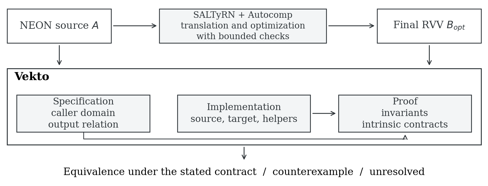
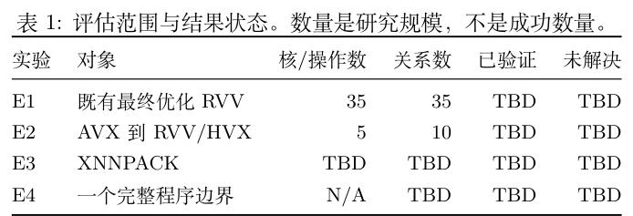
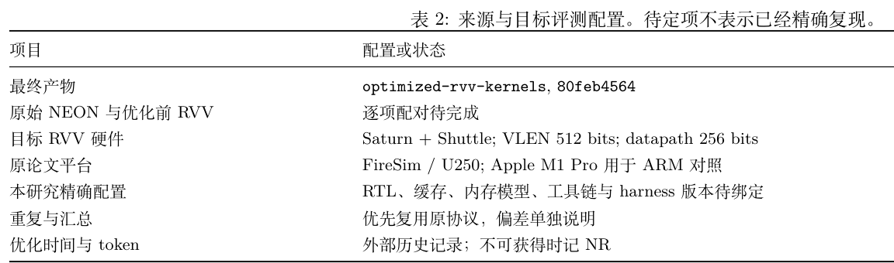
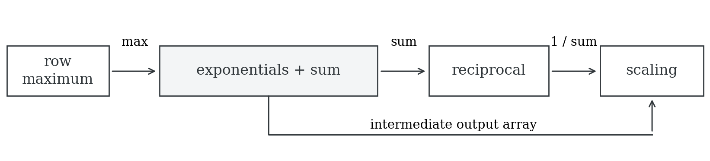
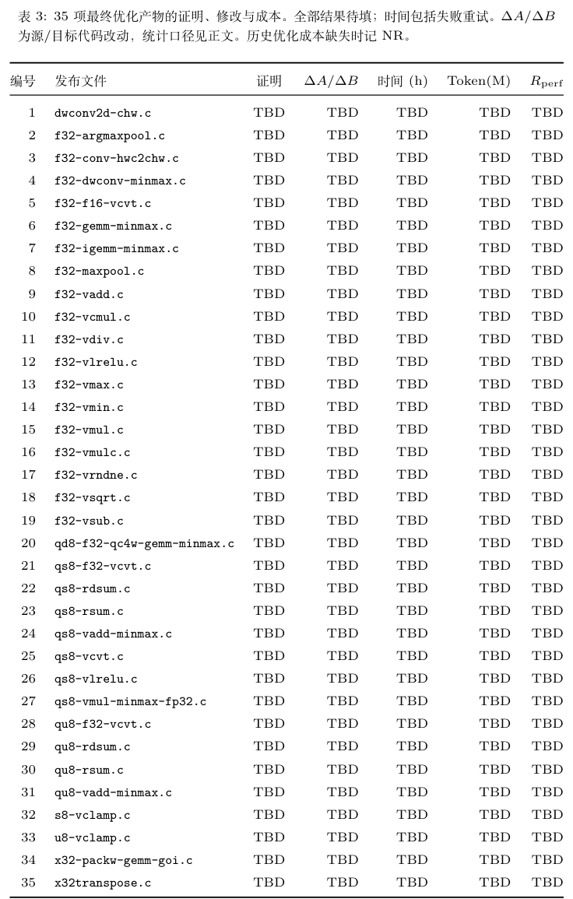
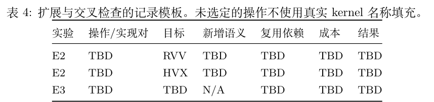
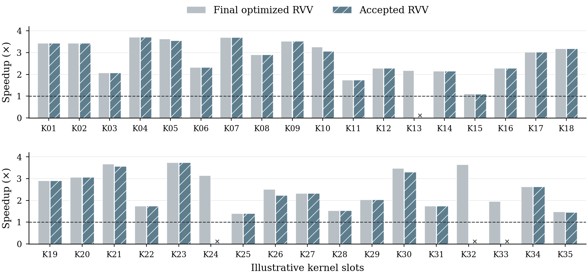

# Vekto：优化 SIMD Kernel 的语义等价性验证

Yuechun Sun · ycsun@berkeley

*讨论稿，2026 年 11 月 3 日。新的评估结果尚未取得，表格保留待填结果。附录 B 的模拟性能图仅用于审阅排版。*

## 摘要

SIMD kernel 的迁移与优化会改变向量宽度、循环结构、内存访问和浮点计算。要判断修改后的实现是否保持源程序行为，需要准确描述合法输入以及调用者能够观察的输出。本文介绍 Vekto 的设计，通过 C 层 intrinsic 语义和模块化程序证明验证这些变换。Vekto 将公共规格、实现与证明分离，使证明开发和 kernel 修改能够分别接受审查。不同指令集的实现通过共同规格建立联系，同时保留各架构的数值和内存行为。评估以 SALTyRN 及其基于 Autocomp 的优化阶段发布的 35 个最终 RVV kernel 为主体，并进一步考察新 ISA 迁移、XNNPACK 独立实现的交叉检查和程序组合。本稿明确验证保证与实验协议，验证覆盖、成本和性能结果仍待建立。

## 1. 引言

高效 SIMD 程序依赖具体架构的细节。使用 Arm NEON intrinsic 编写的 kernel 可以每轮处理固定数量的元素，而 RVV 实现可以在运行时选择活跃向量长度。进一步优化可能改变分块、循环展开、加载方式或累加次序。这些修改提供了性能空间，也改变了证明目标实现可以替换源实现所需的推理。

代码生成 agent 的使用使这一问题更直接地进入开发流程。候选生成与性能搜索可能得到控制流明显不同于源程序的实现。功能测试为受测执行提供证据，而部署还需要确定预期输入域、允许的数值差异，以及测试候选与证明覆盖程序之间的关系。如果证明针对的是为了方便验证而重写的版本，该结论不能直接用于原来的优化候选。

SALTyRN 为这一问题提供了具体背景。它将 XNNPACK 的 NEON kernel 翻译为 RVV，通过有界符号等价检查验证译文，并使用基于 Autocomp 的阶段搜索更快的 RVV 候选。公开说明还包括针对已验证 RVV 基线重新检查最终优化候选的步骤 [1, 2]。Vekto 为这些产物研究一个补充性的验证层，关注保证究竟覆盖哪些长度、参数、内存条件、浮点观察与证明依赖。评估需要具体比较这些范围，不能把已有框架描述成没有验证。

核心设计问题是：可复用的语义与模块化证明，能否在保留优化实现的情况下建立等价性？我们从三个相互关联的要求组织这一问题。规格应描述合法调用，不能仅为简化证明而排除困难情况。证明应覆盖真实实现及其依赖，包括普通 helper 和尾部路径。确有必要的源码修改应保持可见，并分别评估其语义理由和性能影响。

Vekto 通过共同规格连接不同实现的可观察行为。该方法既适用于迁移验证，也适用于交叉检查，因为被比较的独立实现不必来自同一个翻译器。共同规格还提供程序组合的接口，但中间结果的保证必须足以满足使用这些结果的代码。共享语义的价值取决于它能否保留架构之间的重要区别，并在不引入单个 kernel 特定假设的情况下复用。

主实验使用 SALTyRN 单独发布的 35 个最终优化 RVV 源文件 [1]。本研究直接验证这些既有产物，不重新执行优化搜索。另外三组实验分别考察 AVX 到 RVV 和 Hexagon HVX 的迁移、XNNPACK 既有实现的比较，以及由已验证组件构成的小程序。它们用于检验该方法是否适用于单一上游流水线之外的程序。本稿给出设计和实验问题，不声称这些实验已经完成。

## 2. 贯穿示例：向量绝对值

> **作者备注，11 月 4 日：motivating example 待选定。** 下文绝对值暂保留为入门说明。替换案例需要满足以下证据要求，这些要求不代表已经完成的结果。
>
> - 并列展示短小的 NEON 和最终优化 RVV 代码，直观体现向量长度、尾部处理或数值语义的差异，并给出实际 intrinsic 语义定义。
> - 展示验证反馈和合法域内的具体反例，区分求解器生成的 witness 与另外构造或回放的输入。
> - 若候选曾通过 bounded verification，必须找到同一源码的通过记录并解释具体漏检条件。长度 1 的 NaN 差异本身不说明输入长度有界的局限。SALTyRN 已支持反例驱动修复。
> - 展示最小修复及修复后优化实现的验证，保留源程序、合法输入域和优化结构。
> - 同平台比较 XNNPACK RVV、优化 RVV、修复后的优化 RVV，明确标记错误候选并量化修复成本。理想案例在修复后仍快于 XNNPACK，目前尚未建立该证据。
> - 后续 LaTeX 必须使用可编辑源码和语法高亮，不能使用代码截图。此阶段不实施 LaTeX。
>
> 历史 `f32-vmax` 和 `f32-vmin` 是待审候选，但旧证明和测量覆盖中间版本，最终优化版本仍需补证据。详见[候选审阅](MOTIVATING-EXAMPLE-REVIEW.zh-CN.md)。

XNNPACK 的浮点绝对值实现说明，即使操作简单，整段程序的证明也可能不同。NEON 实现按固定分组处理元素，并通过独立 helper 处理尾部。一个 RVV 变体则选择活跃长度，加载相应元素、计算绝对值、写回结果，再减少剩余数量。以下代码来自公开的 `rvv_u1v` 实现 [3]：

```c
const size_t n = __riscv_vsetvl_e32m1(batch);
const vfloat32m1_t vi = __riscv_vle32_v_f32m1(input, n);
input += n;
const vfloat32m1_t vo = __riscv_vfabs_v_f32m1(vi, n);
__riscv_vse32_v_f32m1(output, vo, n);
output += n;
batch -= n;
```

这里的 `batch` 已经从字节数转换为元素数。对齐绝对值操作只解决其中一个证明义务。证明还需要连接已经处理的前缀与输出，说明指针更新始终处于允许访问的内存范围，并覆盖 NEON 尾部 helper 的实际读取。RVV 模型必须说明允许的活跃长度。循环支持不同输入长度，不会自动使一个固定硬件向量长度下的定理覆盖全部硬件配置。

对逻辑输入序列，共同规格描述每个元素的绝对值，以及哪些内存保持不变。不同实现可以采用各自的循环不变量和向量表示，再通过后置条件连接到该规格。这种分解不要求两个循环逐步对应，但仍需分别完成循环的内存与数值证明。

绝对值适合作为初始接入示例，不能代表全部优化 kernel。归约需要处理累加次序，量化程序涉及参数编码、饱和与舍入，矩阵程序还需要处理打包布局和间接访问。这些区别决定哪些事实能够共享，哪些事实必须针对每个实现重新建立。

## 3. 语义合同与等价性保证

### 3.1 逻辑输入、内存与机器配置

设 \(A\) 与 \(B\) 分别为源实现和目标实现。逻辑输入 \(x\) 包含调用者准备提供的数据与操作参数。两侧可以使用不同的向量类型、参数编码或打包布局。前置条件 \(P_A(x)\) 与 \(P_B(x)\) 将两种表示连接到相同逻辑输入，并说明可读与可写内存。

合法域 \(D\) 来自操作及其调用环境，包括形状约束、分配大小、padding、必要的对齐、允许的别名和参数构造方式。这些条件构成保证的一部分。例如，库可以明确允许读取逻辑数组末尾之外的 padding。如果调用合同提供了这部分内存，该读取不构成越界错误，但证明仍需确认分配范围足够。

ISA 配置 \(p_i\) 记录实现 \(i\) 所依赖的向量长度、元素宽度、舍入方式和浮点特殊值行为。定理在该配置允许的输入与执行选择上量化。覆盖任意合法输入长度，与覆盖多个硬件向量长度，是两种不同的性质。

### 3.2 可观察行为

我们比较调用者可见的结果，不要求内部向量寄存器相同。整数输出与数据搬运结果按规格精确比较。主要浮点合同采用以下输出关系：

\[
u \approx_{\mathrm{fp}} v
\quad\Longleftrightarrow\quad
(u =_{\mathrm{num}} v)\;\lor\;
(\operatorname{isNaN}(u)\land\operatorname{isNaN}(v)).
\]

数值相等将正零与负零视为相等，第二个条件忽略 NaN payload。这一关系没有引入任意误差容限，不同的有限浮点数仍不相等。要求精确位模式或精确索引的 kernel 使用对应的更强观察标准。

令 \(O_i\) 提取实现 \(i\) 的规定结果，包括相关输出值和返回信息。对表示同一逻辑调用的初始状态 \(s_A\) 与 \(s_B\)，部分正确性比较可写为：

\[
\begin{aligned}
x\in D\;\land\;P_A(x,s_A)\;\land\;P_B(x,s_B)\;&\land\\
\operatorname{Exec}_{p_A}(A,s_A)\Downarrow t_A\;&\land\;
\operatorname{Exec}_{p_B}(B,s_B)\Downarrow t_B\\
&\Longrightarrow O_A(t_A)\approx O_B(t_B).
\end{aligned}
\]

该命题比较终止执行的结果。内存安全和允许写入区域之外的内存保持是额外证明义务，不能由输出相等推出。若要声称完全正确性或两侧终止行为一致，还必须另行建立终止性。这里的公式说明拟采用的验证判断，不代表本轮已经为评估中的 kernel 检查了新定理。

### 3.3 共同规格

Vekto 将各侧实现的证明与最终比较分开。对实现 \(K_i\)，证明建立形如以下的合同：

\[
\{P_i(x) * R_i\}\;K_i\;\{Q_i(x) * R_i\},
\]

其中 \(*\) 表示内存所有权分离，\(R_i\) 描述保持不变的框架内存。后置条件 \(Q_i\) 将该实现的输出连接到共同规格 \(S(x,o)\)。两侧都满足规格，只有在该规格能够按所选观察关系确定输出时，才足以推出等价：

\[
S(x,o_1)\land S(x,o_2)\Longrightarrow o_1\approx o_2.
\]

一个允许近似误差区间的规格可能接纳两个不同输出，而它们并不满足上面的严格输出关系。分别证明两个实现满足这个规格，可以建立符合性，但不能直接建立输出等价。这一区别对于比较独立优化的库实现尤其重要。

不必把某个 ISA 的实现指定为操作的唯一语义定义。合适的参考规格可以独立描述操作。不过，如果迁移必须保持某一个浮点算法，规格可能需要保留该源程序的累加顺序或近似方法。这一选择必须写清楚，避免把与某个实现等价，混同为相对于理想实数函数的正确性。

### 3.4 补全调用合同

反例可能暴露出当前规格允许了原调用者无法产生的输入。这种情况下，加强前置条件可能合理，但仅能排除该反例还不够。设 \(R(x)\) 描述原设定中的合法调用，\(P_{\mathrm{new}}(x)\) 为新增前置条件，审查义务是：

\[
\forall x.\;R(x)\Longrightarrow P_{\mathrm{new}}(x).
\]

理由应指向具体调用者、参数初始化函数、分配合同或 API 限制，同时解释该条件的必要性。证明新合法域非空，可以辅助排查空泛的定理，却不能说明原来的合法调用都被保留。位于原合法域内的反例需要诊断实现或模型，不能仅通过方便证明的规格限制将其排除。

## 4. 验证架构



*图 1. Vekto 与 SALTyRN 及其基于 Autocomp 的优化阶段的建议关系。上游项目提供既有最终候选，并已进行有界检查。Vekto 组织公共规格、实现证据和证明，建立独立的等价性判断。该图表示研究架构，不表示在线集成已经完成。*

### 4.1 验证抽象层的选择

我们探索过来自 Sail 的汇编语义、显式中间表示，以及 C 层 intrinsic 推理。这些选择暴露出不同的证明义务。汇编语义保留寄存器与架构行为，也要求证明处理相应的内存、机器状态和向量表示。中间表示可以显式统一控制流和内存推理，但需要建立源程序与提取结果的对应。C 层推理保留源代码的循环和函数边界，同时要求准确解释 intrinsic 并说明前端的可信范围。

已有中间表示探索采用名为 CByte 的自定义 C/intrinsic 模型，并非 LLVM IR [4]。CByte 和 C-shim 也不是天然互斥的类别，它们都提供程序的中间语义描述。值得比较的是保留哪些源操作、如何表示内存和数值行为，以及哪些转换仍被信任。选择 C 层合同，是为了利用可复用的程序验证基础设施处理实际提供的 kernel 函数体与 helper。现有证据尚不能说明这一选择普遍比 Sail 或其他 IR 更快。

### 4.2 分离规格、实现与证明

公共规格描述操作、调用域与观察关系。实现部分保留真实源 kernel、目标 kernel 和影响其行为的 helper。证明部分包含循环不变量、布局事实、intrinsic 合同以及公共后置条件的推导。这样的组织使审查者能够识别：一项证明修改是否同时改变了程序或允许的调用。

C-shim 方法通过共享语义接口解释 intrinsic。向量表示、加载与存储、整数运算和浮点操作可以提供可复用定义与引理，但架构特有操作仍保留其实际行为。例如，融合乘加不能悄悄替换为不融合的乘法与加法，minimum 指令的 NaN 行为也不能被理想数学最小值取代。共享接口的价值在于复用这些义务，而不是抹去待验证的区别。

验证器可能为内存访问、分支、循环和函数调用生成许多局部验证条件。如果被调用函数只是被假定满足合同，那么仅证明最终比较函数并不能验证 kernel。最终验收需要包括实际实现的证明，以及主定理使用的依赖。报告还必须标明结论对应的源码、规格、语义模型和配置。

### 4.3 保留优化实现

默认比较保留源实现。若源程序确有缺陷需要修复，该修复应单独审查，不能悄悄并入参考。目标修改也需要记录具体用途，例如纠正语义差异、处理前端边界的表示适配，或者改变程序结构。方便证明的改写并不自动构成合理修复。

确需修改时，评估保留公开优化目标和修改后的目标，明确哪个版本被证明、哪个版本被测量。很小的文本差异仍可能改变舍入或活跃向量长度，而仅添加证明注释未必改变可执行代码。修改记录分别统计两侧可执行代码的新增与删除行数，并包含受影响的 helper；注释和证明文本另计。行数统计辅助审查，但不能替代语义与性能影响的解释。

既有证明可以提供 intrinsic 引理、内存布局论证和不变量模式。复用之前需要将其假设、依赖与机器配置对齐到新候选。共享建设成本与每个 kernel 的增量成本分别报告。没有适当比较时，不预设复用已经降低总成本。

### 4.4 信任边界与实现状态

保证依赖所选语义模型、调用合同和源程序到模型的对应。C 模型中的证明通过检查，不会自动证明所有 intrinsic 模型都符合硬件指令、前端保持原 C 程序语义，或编译器保持最终可执行文件的行为。这些边界应与证明检查器的验收状态分别报告。

早期原型提供了证明基础设施和处理中间版本 kernel 的经验，不构成本研究 35 个最终优化产物的结果。历史汇编证明、生成 trace 和条件性定理也保留各自原有范围。将结果用于最终优化集合之前，必须重新绑定源码身份并取得相应证明证据。

## 5. 评估

### 5.1 研究问题与对象

评估围绕四个问题展开：Vekto 能否在保留结构和性能的情况下验证既有优化实现，扩展语义接口需要多少工作，独立实现比较能够揭示什么，以及合同能否覆盖一个完整程序边界。

<!-- TABLE:scope:zh:BEGIN -->


LaTeX 源码：[scope.zh.tex](tables/scope.zh.tex). [编译预览](tables/tables.zh.pdf).

<details>
<summary>展开 LaTeX 源码</summary>

```latex
\begin{table}[htbp]
\centering
\small
\caption{评估范围与结果状态。数量是研究规模，不是成功数量。}
\label{tab:scope}
\begin{tabular}{@{}llrrrr@{}}
\toprule
实验 & 对象 & 核/操作数 & 关系数 & 已验证 & 未解决 \\
\midrule
E1 & 既有最终优化 RVV & 35 & 35 & TBD & TBD \\
E2 & AVX 到 RVV/HVX & 5 & 10 & TBD & TBD \\
E3 & XNNPACK & TBD & TBD & TBD & TBD \\
E4 & 一个完整程序边界 & N/A & TBD & TBD & TBD \\
\bottomrule
\end{tabular}
\end{table}
```

</details>
<!-- TABLE:scope:zh:END -->

主实验集合是最终产物仓库提交 `80feb4564cb470de301062109b6f89db672bdf9d` 中的全部 35 个 C 文件 [1]，不根据证明成功情况筛选。每个目标还需要配对 NEON 源程序、记录调用合同，并绑定对应测试驱动。随包数据提供完整来源清单。另外五个 AVX 操作是计划样本，尚未全部选定。优先选择固定目标库版本中缺少实现的操作，缺失与否应按操作检查，而不能仅由没有某个文件名推断。

### 5.2 实验配置

性能设置优先采用 SALTyRN 的目标和协议。归档论文描述的是 Saturn 向量单元与 Shuttle 核，VLEN 为 512 bit、数据通路宽度为 256 bit，通过 U250 FPGA 上的 FireSim 评估；ARM 测量使用 Apple M1 Pro。归档论文与后来发布的 35 项仓库属于不同产物，比较前需要建立样本和配置之间的映射 [1, 2]。

<!-- TABLE:setup:zh:BEGIN -->


LaTeX 源码：[setup.zh.tex](tables/setup.zh.tex). [编译预览](tables/tables.zh.pdf).

<details>
<summary>展开 LaTeX 源码</summary>

```latex
\begin{table}[htbp]
\centering
\small
\caption{来源与目标评测配置。待定项不表示已经精确复现。}
\label{tab:setup}
\begin{tabular}{@{}p{.24\linewidth}p{.67\linewidth}@{}}
\toprule
项目 & 配置或状态 \\
\midrule
最终产物 & \texttt{optimized-rvv-kernels}, \texttt{80feb4564} \\
原始 NEON 与优化前 RVV & 逐项配对待完成 \\
目标 RVV 硬件 & Saturn + Shuttle; VLEN 512 bits; datapath 256 bits \\
原论文平台 & FireSim / U250; Apple M1 Pro 用于 ARM 对照 \\
本研究精确配置 & RTL、缓存、内存模型、工具链与 harness 版本待绑定 \\
重复与汇总 & 优先复用原协议，偏差单独说明 \\
优化时间与 token & 外部历史记录；不可获得时记 NR \\
\bottomrule
\end{tabular}
\end{table}
```

</details>
<!-- TABLE:setup:zh:END -->

一次 RVV 比较中的全部实现使用相同目标配置、编译选项、逻辑输入、打包方式与计时协议。在能够恢复的情况下复用原预热与汇总方式；如果为估计波动增加重复测量，应说明其与原协议的关系。若原 FPGA 配置不可用，只有在明确目标和时序模型后，才能将软件 RTL 或 metasimulation 作为替代。向量宽度相同并不足够。仿真宿主时间衡量实验执行速度，不是 kernel 的目标执行周期。不同 ARM 机器上的结果应单列，不能冒充 M1 Pro 的精确复现。

### 5.3 E1：既有优化 kernel 的验证

对每个样本，\(A\) 为 NEON 源程序，\(B_0\) 为可获得时的优化前 RVV 基线，\(B_{\mathrm{opt}}\) 为公开最终优化目标，\(B_{\mathrm{acc}}\) 为验证和必要修复之后的验收目标。主要义务是 \(A\approx B_{\mathrm{opt}}\)；若候选需要修改，则明确报告 \(A\approx B_{\mathrm{acc}}\)。如果要单独声称优化步骤保持语义，还需要建立与 \(B_0\) 的关系。

性能指标区分优化收益与验证相关修改的影响：

\[
S_{\mathrm{opt}}=\frac{T(B_0)}{T(B_{\mathrm{opt}})},\qquad
S_{\mathrm{acc}}=\frac{T(B_0)}{T(B_{\mathrm{acc}})},\qquad
R_{\mathrm{perf}}=\frac{T(B_{\mathrm{opt}})}{T(B_{\mathrm{acc}})}.
\]

\(T\) 为同一协议下的执行成本。保留比小于一，表示验收目标更慢。公开目标原样验收时，两版本相同。若无法恢复 \(B_0\)，优化加速比保持缺失；手写 RVV 可以作为另一项明确命名的基线，不能替换分母而不说明。已经确认有正确性问题的候选，其执行成本只作为诊断数据，不作为已验证加速结果。

验证状态区分证明通过、已复现反例、未解决义务与环境故障。成本记录包含失败尝试和恢复，共享模型建设与监督开销单列。输入、缓存输入与输出 token 保留测量接口的定义，避免重复累加。历史优化成本属于外部数据，没有日志时使用 NR，不根据当前验证成本反推。附录 A 的表 3 给出逐 kernel 的记录形式。

**结果待补。** 本稿不声称最终集合的验证成功率、成本或实测性能比值。附录 B 仅用模拟数据展示性能图的排版。

### 5.4 E2：扩展到新实现

扩展实验考虑五个 AVX 操作，每个分别迁移到 RVV 和 HVX，操作数量与计划的十条源到目标关系分开统计。每条关系记录新增 intrinsic 语义、复用的证明依赖、实现与证明改动以及总验证成本。用于接通前端的简单操作，只有满足选样标准时才计入五个新样本。

本实验从两个层面考察复用：共同规格在不同实现之间是否仍然适用，已有语义与证明组件是否减少新增实现工作。列出复用组件本身不能证明耗时或 token 的因果性降低。降低成本的结论需要可比任务和受控条件。最终操作清单和结果仍待取得。

### 5.5 E3：XNNPACK 实现的交叉检查

XNNPACK 为共同操作选择不同架构的 kernel。例如，绝对值配置会分派到 NEON、AVX、RVV 或 HVX 实现。测试也使用共同参考操作，但比较标准随操作变化：数据搬运可以逐字节检查，部分数值操作则允许误差 [5]。因此，相同操作名提供候选索引，不代表普遍的严格等价承诺。

初始候选包括绝对值、整数限幅与转置。每组实现需要对齐逻辑输入、参数初始化、布局和合法内存。证明失败在获得反例或具体原因之前归为未解决。获得反例后，还需核实其属于原调用域，并在适当硬件或明确范围的模拟器上对原程序复现。只有可行且违反预期合同的差异才成为 bug 候选。允许的近似差异、模型错误和不可行输入单独报告。任何上游补丁建议都需要复现与理由，维护者是否接受属于另一个结果。

### 5.6 E4：程序组合

完整 Softmax 算子是组合验证的一个候选。XNNPACK 的浮点路径依次取得一行的最大值，计算指数及其和，形成倒数，再缩放已经存储的中间值 [6]。这个边界包含多个 kernel 与标量连接代码，但仍是一个算子，不是完整推理应用。



*图 2. Softmax 候选计算的依赖关系。指数阶段同时产生中间输出数组和求和结果，缩放阶段读取该数组与求和结果的倒数。最终证明还需覆盖 wrapper 的逐行迭代、步长、内存所有权和参数设置。本图不表示应用级证明已经完成。*

现有 NEON 与 RVV 配置选择了不同的指数近似路径 [6]，不能预设其输出严格等价。一种可选路线是构造保持指定 NEON 算法的 RVV 版本，包括相同近似方法和累加次序，再证明整个计算。这样建立的是与源程序的等价性，不会同时宣称获得相对于数学指数函数的误差界。

程序组合不能只依赖各组件孤立的最终输出关系。正零与负零虽然在最终输出观察下相同，却可能被后续取倒数操作区分。因此，中间规格需要保留消费者使用的信息，或者证明消费者在合法调用中不会区分允许的差异。最终应用边界与证明仍待确定。

## 6. 案例与结果分析

三个案例将把汇总测量连接到具体的验证决策。实际程序与证据选定之前，对应结果段保持空缺。

### 6.1 保留一项优化

第一个案例需要指出真实的分块、活跃长度或累加组织变化，以及该变化带来的证明义务。比较公开优化目标与验收版本，包括 helper 修改和实测性能影响。所需证据包括源码差异、完整证明结果和配对计时。不能仅凭整项修改前后的性能差异，将减速归因于某一处修复；这种归因需要隔离对照或其他直接观测。

### 6.2 原调用域之外的反例

第二个案例将反例追溯到使其不可行的调用者或参数构造过程。需要展示新旧前置条件，解释新增条件为什么必要，并论证原合法调用仍被覆盖。仅在修改后展示一个有效输入，不能证明这一覆盖。本稿尚未为最终样本选定并验证具体反例，因此不虚构案例。

### 6.3 独立实现之间的差异

第三个案例依据操作合同和可执行复现，区分真实实现错误与允许的数值差异。如果没有发现新的实现缺陷，则使用有证据支持的合同或组合问题，不将其改称 bug。跨案例分析需要将证明失败连接到具体指令、访存或前端不支持的构造，不能用一个未解释的抽象标签代替机制。

## 7. 相关工作

SALTyRN 和 Autocomp 处理候选生成与优化。SALTyRN 将迁移、有界符号检查和 RVV 优化后端连接起来，Autocomp 提供硬件反馈指导的优化搜索 [1, 2, 7]。本研究使用其最终产物。比较既有检查与本方法时，应先对齐输入域和观察标准，再讨论新增覆盖或成本。

MetaLift 与 Tenspiler 展示了利用语义表示连接源程序与领域特定实现的方法 [8, 9]，是共享规格和 verified lifting 的相关工作。Vekto 关注已有 intrinsic 实现，包括具体数值与内存行为。仅仅使用共享表示或支持多个目标，本身不构成新的贡献。

验证工具的经验论文区分工具能够支持的性质，以及表达和检查这些性质所需的工作 [10]。这种区分要求我们在成功数量之外报告调用条件、未完成证明义务、程序修改和资源成本。GraphicsFuzz 的生产实践也将差异诊断与缩减纳入证据 [11]。对 Vekto 而言，两个实现一致只有在其规格和模型的范围内才有意义；共同错误仍可能不被发现。

## 8. 局限与结语

当前设计没有提供经过验证的编译器或无条件机器码定理。结论依赖所选 intrinsic 模型、前端对应、调用域和 ISA 配置。忽略最终 NaN payload 与有符号零，会限制输出等价定理能够直接使用的调用环境。跨 kernel 复用也必须满足被复用组件的假设。

最终优化集合提供了具体评估对象，用于检验模块化 C 层证明能否保留有实际价值的优化实现。其他实验进一步考察新后端、独立维护的库代码和程序组合。这些问题需要实验回答，其失败情况和真实成本也应决定论文最终能够提出的结论。本稿建立理解这些结果所需的定义与报告结构。

## 附录 A. 逐 kernel 的证据与成本

表 3 列出实际发布的 35 个文件名，区分证明状态、源/目标修改、验证时间、token 与性能保留比。TBD 表示尚未提供结果，不表示零成本或证明失败；NR 专用于缺失的历史优化记录。随包提供可编辑 LaTeX 源码和编译预览。完整证明记录还需绑定规格、依赖与硬件配置。

<!-- TABLE:kernels:zh:BEGIN -->


LaTeX 源码：[kernels.zh.tex](tables/kernels.zh.tex). [编译预览](tables/tables.zh.pdf).

<details>
<summary>展开 LaTeX 源码</summary>

```latex
{\scriptsize
\setlength{\tabcolsep}{5pt}
\renewcommand{\arraystretch}{1.17}
\begin{longtable}{@{}rlcrrrr@{}}
\caption{35 项最终优化产物的证明、修改与成本。全部结果待填；时间包括失败重试。$\Delta A/\Delta B$ 为源/目标代码改动，统计口径见正文。历史优化成本缺失时记 NR。}\label{tab:kernels}\\
\toprule
编号 & 发布文件 & 证明 & $\Delta A/\Delta B$ & 时间(h) & Token(M) & $R_{\mathrm{perf}}$ \\
\midrule
\endfirsthead
\toprule
编号 & 发布文件 & 证明 & $\Delta A/\Delta B$ & 时间(h) & Token(M) & $R_{\mathrm{perf}}$ \\
\midrule
\endhead
\bottomrule
\endfoot
1 & \texttt{dwconv2d-chw.c} & TBD & TBD & TBD & TBD & TBD \\
2 & \texttt{f32-argmaxpool.c} & TBD & TBD & TBD & TBD & TBD \\
3 & \texttt{f32-conv-hwc2chw.c} & TBD & TBD & TBD & TBD & TBD \\
4 & \texttt{f32-dwconv-minmax.c} & TBD & TBD & TBD & TBD & TBD \\
5 & \texttt{f32-f16-vcvt.c} & TBD & TBD & TBD & TBD & TBD \\
6 & \texttt{f32-gemm-minmax.c} & TBD & TBD & TBD & TBD & TBD \\
7 & \texttt{f32-igemm-minmax.c} & TBD & TBD & TBD & TBD & TBD \\
8 & \texttt{f32-maxpool.c} & TBD & TBD & TBD & TBD & TBD \\
9 & \texttt{f32-vadd.c} & TBD & TBD & TBD & TBD & TBD \\
10 & \texttt{f32-vcmul.c} & TBD & TBD & TBD & TBD & TBD \\
11 & \texttt{f32-vdiv.c} & TBD & TBD & TBD & TBD & TBD \\
12 & \texttt{f32-vlrelu.c} & TBD & TBD & TBD & TBD & TBD \\
13 & \texttt{f32-vmax.c} & TBD & TBD & TBD & TBD & TBD \\
14 & \texttt{f32-vmin.c} & TBD & TBD & TBD & TBD & TBD \\
15 & \texttt{f32-vmul.c} & TBD & TBD & TBD & TBD & TBD \\
16 & \texttt{f32-vmulc.c} & TBD & TBD & TBD & TBD & TBD \\
17 & \texttt{f32-vrndne.c} & TBD & TBD & TBD & TBD & TBD \\
18 & \texttt{f32-vsqrt.c} & TBD & TBD & TBD & TBD & TBD \\
19 & \texttt{f32-vsub.c} & TBD & TBD & TBD & TBD & TBD \\
20 & \texttt{qd8-f32-qc4w-gemm-minmax.c} & TBD & TBD & TBD & TBD & TBD \\
21 & \texttt{qs8-f32-vcvt.c} & TBD & TBD & TBD & TBD & TBD \\
22 & \texttt{qs8-rdsum.c} & TBD & TBD & TBD & TBD & TBD \\
23 & \texttt{qs8-rsum.c} & TBD & TBD & TBD & TBD & TBD \\
24 & \texttt{qs8-vadd-minmax.c} & TBD & TBD & TBD & TBD & TBD \\
25 & \texttt{qs8-vcvt.c} & TBD & TBD & TBD & TBD & TBD \\
26 & \texttt{qs8-vlrelu.c} & TBD & TBD & TBD & TBD & TBD \\
27 & \texttt{qs8-vmul-minmax-fp32.c} & TBD & TBD & TBD & TBD & TBD \\
28 & \texttt{qu8-f32-vcvt.c} & TBD & TBD & TBD & TBD & TBD \\
29 & \texttt{qu8-rdsum.c} & TBD & TBD & TBD & TBD & TBD \\
30 & \texttt{qu8-rsum.c} & TBD & TBD & TBD & TBD & TBD \\
31 & \texttt{qu8-vadd-minmax.c} & TBD & TBD & TBD & TBD & TBD \\
32 & \texttt{s8-vclamp.c} & TBD & TBD & TBD & TBD & TBD \\
33 & \texttt{u8-vclamp.c} & TBD & TBD & TBD & TBD & TBD \\
34 & \texttt{x32-packw-gemm-goi.c} & TBD & TBD & TBD & TBD & TBD \\
35 & \texttt{x32transpose.c} & TBD & TBD & TBD & TBD & TBD \\
\end{longtable}
}
```

</details>
<!-- TABLE:kernels:zh:END -->

后续实验采用下面的记录结构。E2 每个操作有两行目标实现，E3 则分别记录实现对。展示的是表格模板，不表示样本已经选定或已取得结果。

<!-- TABLE:extension:zh:BEGIN -->


LaTeX 源码：[extension.zh.tex](tables/extension.zh.tex). [编译预览](tables/tables.zh.pdf).

<details>
<summary>展开 LaTeX 源码</summary>

```latex
\begin{table}[htbp]
\centering
\small
\caption{扩展与交叉检查的记录模板。未选定的操作不使用真实 kernel 名称填充。}
\label{tab:extension}
\begin{tabular}{@{}lllllll@{}}
\toprule
实验 & 操作/实现对 & 目标 & 新增语义 & 复用依赖 & 成本 & 结果 \\
\midrule
E2 & TBD & RVV & TBD & TBD & TBD & TBD \\
E2 & TBD & HVX & TBD & TBD & TBD & TBD \\
E3 & TBD & TBD & N/A & TBD & TBD & TBD \\
\bottomrule
\end{tabular}
\end{table}
```

</details>
<!-- TABLE:extension:zh:END -->

## 附录 B. 性能图排版预览



*图 3. 模拟数据排版示例，不是实验结果。全部柱高均为虚构数值。K01 至 K35 是排版位置，没有映射真实 kernel 清单。两组柱采用假设的同一优化前 RVV 基线，基准为 1×。验收版本缺失的柱表示示例结果缺失，不表示零性能。不能从此图推断真实实现的置信区间或研究结论。正式图将使用第 5.3 节协议取得的测量值。*

## 参考文献

1. SALTyRN authors. [Optimized RVV Kernels](https://github.com/keaganchern/optimized-rvv-kernels/tree/80feb4564cb470de301062109b6f89db672bdf9d)。最终产物仓库，固定提交 `80feb4564cb470de301062109b6f89db672bdf9d`。
2. SALTyRN authors. [SALTyRN: Turning NEON Kernels into Fast, Verified RVV Code with LLMs](https://riseproject.dev/2026/07/27/saltyrn-turning-neon-kernels-into-fast-verified-rvv-code-with-llms/)。作者报告，2026。归档论文是另一个版本，基础设施描述及来源记于 [来源记录](sources/README.md)。
3. XNNPACK contributors. [RVV absolute value](https://github.com/google/XNNPACK/blob/23dd5070fa002ef0b124817798ae090fa29f9653/src/f32-vunary/gen/f32-vabs-rvv-u1v.c) 与 [NEON variants](https://github.com/google/XNNPACK/blob/23dd5070fa002ef0b124817798ae090fa29f9653/src/f32-vunary/gen/f32-vabs-neon.c)。固定源码快照。
4. Arcadia-Y. [SALTyRN verification model and extraction boundaries](https://github.com/Arcadia-Y/SALTy-rn/blob/4a0627dc72d39de8b8e5c1971bcc23b267e2d4ca/verification/README.md)。固定研究分支文档，不代表本次重新运行证明。
5. XNNPACK contributors. [Unary dispatch](https://github.com/google/XNNPACK/blob/23dd5070fa002ef0b124817798ae090fa29f9653/src/configs/unary-elementwise-config.c)、[unary tests](https://github.com/google/XNNPACK/blob/23dd5070fa002ef0b124817798ae090fa29f9653/test/vunary-microkernel-tester.h) 与 [transpose tests](https://github.com/google/XNNPACK/blob/23dd5070fa002ef0b124817798ae090fa29f9653/test/xN-transpose.cc)。
6. XNNPACK contributors. [Softmax execution](https://github.com/google/XNNPACK/blob/23dd5070fa002ef0b124817798ae090fa29f9653/src/operator-run.c#L1881) 与 [exponential-kernel configuration](https://github.com/google/XNNPACK/blob/23dd5070fa002ef0b124817798ae090fa29f9653/src/configs/raddstoreexpminusmax-config.c)。
7. Charles Hong, Sahil Bhatia, Alvin Cheung, Yakun Sophia Shao. [Autocomp: LLM-Driven Code Optimization for Tensor Accelerators](https://arxiv.org/abs/2505.18574v3)。arXiv，版本 3。
8. Sahil Bhatia, Sumer Kohli, Sanjit A. Seshia, Alvin Cheung. [Building Code Transpilers for Domain-Specific Languages Using Program Synthesis](https://doi.org/10.4230/LIPIcs.ECOOP.2023.38)。ECOOP 2023。
9. Jie Qiu 等. [Tenspiler: A Verified-Lifting-Based Compiler for Tensor Operations](https://doi.org/10.4230/LIPIcs.ECOOP.2024.32)。ECOOP 2024。
10. João Mota, Marco Giunti, António Ravara. [On Using VeriFast, VerCors, Plural, and KeY to Check Object Usage](https://doi.org/10.4230/LIPIcs.ECOOP.2023.40)。ECOOP 2023。
11. Alastair F. Donaldson, Hugues Evrard, Paul Thomson. [Putting Randomized Compiler Testing into Production](https://doi.org/10.4230/LIPIcs.ECOOP.2020.22)。ECOOP 2020。
