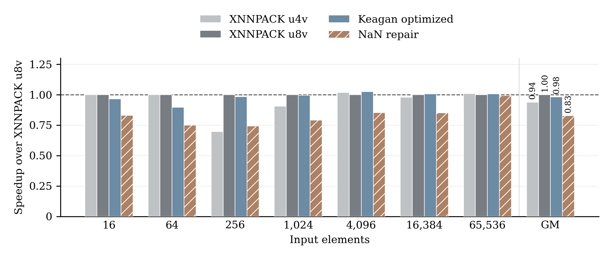

# vmax 的同平台性能测量

本次测的是 35 个最终输出中的 vmax，未测 vmin。四个实现使用相同的有限输入、编译器、Saturn RTL 配置与计时流程。

## 结论

- 相对 XNNPACK u8v，Keagan 最终优化版的七尺寸几何平均速度为 **0.982×**，修复版为 **0.826×**。本轮没有显示最终版有明显优势。
- 修复后周期相对优化版增加 **18.8%**（周期比的几何平均），等价于吞吐下降 **15.8%**。这两个百分比的分母不同，不能混用。
- 修复成本随尺寸变化，见下表。它保留原循环和 LMUL，只在两处 min/max 后分别增加 4 条 C 语句：两次 NaN 检测、一次 mask OR、一次 canonical NaN 选择。
- 当前不宜把 vmax 写成“优化显著快于 XNNPACK，且修复几乎无损”的主例。它已有很清楚的语义模型诊断证据，可以保留为正确性案例。

## 逐尺寸周期

每格取一次独立启动内预热一次后 3 次计时的中位数。不是 3 个独立进程或随机种子，也没有置信区间。

| 输入元素数 | XNN u4v | XNN u8v | Keagan 最终版 | NaN 修复版 | 最终版 / XNN u8v 速度 | 修复周期增加 |
| :--- | ---: | ---: | ---: | ---: | ---: | ---: |
| 16 | 54 | 54 | 56 | 65 | 0.964× | 16.1% |
| 64 | 60 | 60 | 67 | 80 | 0.896× | 19.4% |
| 256 | 182 | 127 | 129 | 171 | 0.984× | 32.6% |
| 1,024 | 473 | 428 | 430 | 541 | 0.995× | 25.8% |
| 4,096 | 1,721 | 1,752 | 1,708 | 2,055 | 1.026× | 20.3% |
| 16,384 | 6,991 | 6,845 | 6,801 | 8,052 | 1.006× | 18.4% |
| 65,536 | 96,036 | 96,874 | 96,161 | 97,594 | 1.007× | 1.5% |

GM 对每种尺寸等权，不按真实应用频率加权。三次原始样本均保存在 [results.json](results.json)，包括较慢的首个计时样本，未只选最快样本。小幅差异不足以支持显著优越性的结论。

图：同一 Saturn RTL 配置中的有限输入性能。纵轴为 XNNPACK u8v 周期 / 当前实现周期，越高越快，GM 为七尺寸几何平均。原优化版和 XNNPACK 的单侧 NaN 行为均不同于 NEON，图中的速度不能作为其全域等价性证据。修复版已做回归检查，尚未完成正式证明。没有使用模拟数据。

## 平台与测量协议

- 本地 Verilator Saturn RTL，GENV512D256ShuttleConfig，VLEN512/DLEN256，DRAMSim2，seed1，日志报告 CPU 500 MHz、DRAM 666.7 MHz。直接报告目标 cycles，不是宿主运行时间或 QEMU 指令数。
- 四个 simulator 使用独立工作目录并行运行，避免 DRAM 输出文件相互覆盖。
- GCC 15.2.0，O3，RV64GCV，关闭 FP contraction，未开 fast-math。每个 kernel 单独编译，统一添加 noipa，tester 禁止自动向量化。完整命令、ELF、源码、模拟器和 DRAM 配置哈希均保留。
- 输入为相同的预生成有限数序列，直接放入 ELF，输出按 4096 字节对齐。数据生成和逐元素输出检查在计时区外。每个尺寸一次预热，随后三次 fence/rdcycle 计时，fence 成本包含在结果中。
- 各尺寸测量后检查全部有限输入输出以及输出区外哨兵。所有四个 RTL 运行均输出 PASS。
- 未测含 NaN 的输入分布性能；修复代码没有根据“测试没有 NaN”关闭检查。
- 这不是 Keagan 论文性能的精确复现。硬件 preset、编译器、输入与计时配置需要单独对齐；本次只建立四版本之间一致的本地对照。

## 来源与正确性边界

Keagan 源码来自 `optimized-rvv-kernels@80feb4564cb470de301062109b6f89db672bdf9d`。XNNPACK 来自 `867d5a344790802ee067be62f572c2e2722bf6fb` 的 u4v、u8v 文件，仅重命名入口为 test_rvv。保留原源码，不把适配副本冒充上游文件。

XNNPACK u4v/u8v 和 Keagan 原版在单侧 NaN 输入时都返回数值操作数。因而有限输入性能比较的计算任务相同，修复版承担了额外的 NEON NaN 传播语义。本轮不据此断言 XNNPACK 违反其自身 API 契约。

计时所用的同一个 GCC kernel 对象先在 QEMU VLEN128/256/512 检查。每版本 180 个调用覆盖单侧 NaN、双侧 NaN和有限输入；修复版另外与未改动的 ARM NEON 做混合 lane 比较，每个 VLEN 比较 1,762 个输出，含 qNaN、sNaN、Inf、正负零、subnormal 和伪随机位模式。按数值相等或双方 NaN 比较，全部通过。这些是新回归测试，不替代全输入形式证明或实际芯片测量。

## 工件

- [结构化汇总](summary.json)、[逐尺寸 CSV](per-size.csv)、[原始样本](results.json)、[环境](environment.json)。
- [修复 diff](repair.patch)、[修复源码](sources/repaired.c)、[最终原源码](sources/optimized.c)。
- [测量脚本](measure.py)、[混合输入检查](mixed-check/results.json)、[绘图与汇总脚本](summarize.py)。
- [PDF 图](figures/vmax-performance.pdf)、[SVG 图](figures/vmax-performance.svg)。

## 可解释范围

反汇编确认修复额外执行了 vmfne、vmor 和 vfmerge。性能变化与这组代码改动一起出现，但此次没有做硬件计数器或瓶颈消融，不能把全部增量归因于某条指令。最大尺寸上四个版本更接近，可能与访存成本占比有关，这只是解释候选。
